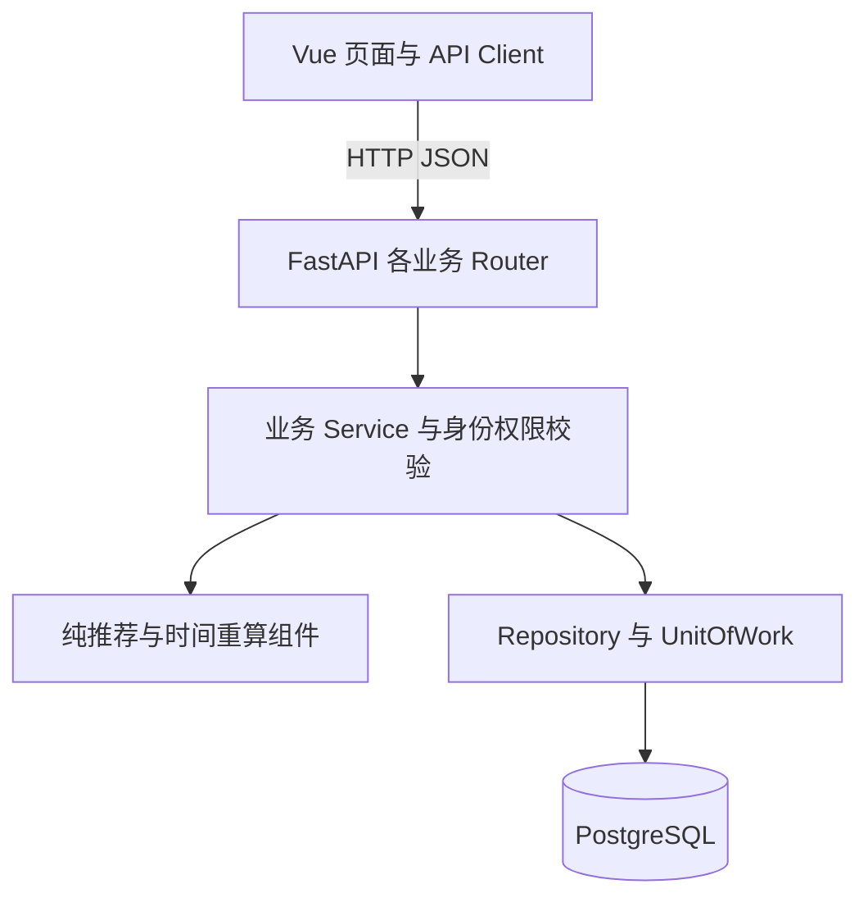

# ADR-001：采用前后端分离的模块化单体架构

| 项目 | 内容 |
| --- | --- |
| 项目 | 智游北京——智慧旅游行程规划与景点服务平台 |
| 课程 | 高级软件工程 |
| 决策编号 | ADR-001 |
| 记录日期 | 2026-10-13 |
| 状态 | Proposed：个人预评审建议，待真实小组讨论确认 |
| 对应架构基线 | 2026-10-03，版本 1.0 |
| 关联评审 | [architecture-review.md](./architecture-review.md)，AR-001、AR-002、AR-007、AR-009 |

> 当前尚未组建真实小组。本文根据现有需求和 Agent 架构建议，从不同职责角度进行模拟分析，不记载虚构的参会人员、投票或签字。需求文件中的“4 人、两周”为原计划约束，不表示当前已有四名成员到位。

## 1. 需要解决的问题

智游北京需要支持景点查询、账号权限、收藏、规则推荐、行程管理、模拟预约、预约后评价和管理后台。项目既要完成课程演示，也要体现模块划分、接口契约、数据完整性和可测试性。

本次决策回答：**这些业务应部署为多个独立服务，还是在一个后端应用内按模块组织？** 同时明确前后端、业务层和数据库的职责，避免“选择单体”最后变成所有代码集中在一个文件。

本记录展开 [总体架构 §12](./architecture.md) 中已有的 ADR-001，沿用原编号，不新增一项含义不同的 ADR。会话、推荐算法和历史快照仍分别属于总体架构中的 ADR-002、ADR-003、ADR-005，不合并到本决策编号下。

## 2. 背景与约束

| 约束 | 依据 | 对架构选择的影响 |
| --- | --- | --- |
| 课程项目，原计划 4 人、暂定两周 | 需求 §5、DEC-003 | 优先控制开发、部署和联调成本；实际组员未到位是额外进度风险 |
| Vue、FastAPI、PostgreSQL 已确定 | DEC-017 | 在既定技术栈内选择组织方式，不重新更换整套框架 |
| 本机运行与演示 | DEC-018 | 不需要服务集群、云资源、域名或公网部署 |
| 北京单城，约 20～30 个景点 | DEC-006 | 当前数据规模不构成分布式处理的必要条件 |
| 规则推荐，不依赖大语言模型 | DEC-007 | 推荐可作为纯计算模块，与数据库和外部地图解耦 |
| 预约是模拟业务 | DEC-010 | 不引入支付、真实库存及票务平台集成 |
| 保存行程、预约写入必须完整 | NFR-REL-001 | 优先使用一个数据库事务保证相关记录同时成功或回滚 |
| 服务端校验角色及资源所有者 | NFR-SEC-002、NFR-SEC-004 | 身份与权限策略需要统一执行，而不是各模块自行解释 |

依据文件：[需求规格说明书](../requirements/requirements.md)、[决策记录](../requirements/open-questions.md)、[验收标准](../requirements/acceptance-criteria.md)。

## 3. 决策驱动因素

评估架构时，按以下顺序考虑：

1. 能否在课程周期内完成所有 Must 功能及核心演示闭环。
2. 能否可靠处理个人数据隔离、重复预约、评价唯一性和写入回滚。
3. 能否让不同业务模块分别开发和测试，且接口边界明确。
4. 能否在一台电脑上重复启动、导入种子数据和排查错误。
5. 能否在后续功能增长时保留调整空间。

当前没有需要独立发布、独立扩容或跨地域运行的已确认要求，因此这些能力不作为首要决策依据。

## 4. 候选方案比较

以下比较为基于本项目约束的定性判断，不是实测性能结果。B、C 是本次分析提出的对照方案，不冒充 Agent 已经推荐过的方案。

| 维度 | A：模块化单体 | B：按业务拆成微服务 | C：集中式简单单体 |
| --- | --- | --- | --- |
| 代码组织 | 按领域分模块，模块内分层 | 每个业务单独服务 | 路由、SQL 与规则集中编写 |
| 后端部署 | 一个后端应用 | 多个服务及服务间连接 | 一个后端应用 |
| 行程保存一致性 | 同一数据库事务 | 若数据分库，需要额外协调 | 可以使用事务，但容易散落在路由中 |
| 权限规则 | 统一身份依赖和所有者查询 | 每个服务都要一致执行身份策略 | 容易在部分入口遗漏 |
| 并行协作 | 按模块与契约划分责任 | 可独立协作，但联调和部署增加 | 多人修改同一文件时冲突较多 |
| 单元测试 | 推荐和状态逻辑可独立测试 | 可测试，但还需服务间集成测试 | 业务与数据库耦合，测试困难 |
| 本机演示 | 启动步骤少 | 服务较多，故障定位链路长 | 启动简单 |
| 后续维护 | 有明确边界，需要持续约束 | 独立发布能力强，运维要求更高 | 初期快，业务增长后维护成本上升 |
| 本项目判断 | 推荐采用 | 当前不采用 | 当前不采用 |

微服务并非技术上不可行，而是本项目尚未出现足以抵消其额外成本的需求。集中式简单单体虽然减少初期文件数量，但无法很好体现课程要求的模块设计和可维护性。

## 5. 从不同职责角度进行模拟评估

下表是分析视角，不是真实参会人员的发言记录。

| 分析视角 | 关注问题 | 对方案 A 的意见 | 保留条件 |
| --- | --- | --- | --- |
| 前端与交互 | API 能否稳定、字段错误和编辑结果能否统一处理 | 一个 API 入口便于联调；前后端分离支持独立页面开发 | 以 api-design.md 为契约，不让前端依赖 ORM 字段 |
| 后端与安全 | 登录、所有者判断和事务是否会被不同模块重复实现 | 共享身份依赖与 UOW 有利于保持一致 | Router 不执行业务事务，Repository 不自行提交 |
| 推荐与数据 | 推荐是否受数据库、地图或模型可用性影响 | 纯规则引擎可用固定候选数据测试 | 引擎不访问数据库；输入为完整候选快照 |
| 测试与集成 | 一台电脑能否运行闭环并验证异常情况 | 单应用和单库降低演示准备成本 | 仍须测试并发、防越权和回滚，不能以单体代替质量验证 |

模拟分析的主要分歧是：单体会不会削弱模块独立性？处理办法是将“一个部署单元”和“多个代码模块”分开设计。独立性通过目录、服务接口、数据所有权和测试边界体现，不要求每个模块立即成为独立进程。

## 6. 建议决策

建议继续采用**前后端分离的模块化单体**作为当前课程项目架构基线：

- 前端使用 Vue，通过 `/api/v1` 调用后端，不直接访问数据库。
- 后端使用一个 FastAPI 应用，通过业务 Router 组织账号、景点、收藏、行程、预约、评价和管理入口。
- 模块内使用 `Router → Service → Repository` 分层；推荐与时间重算保持为纯计算组件。
- 业务服务通过 UnitOfWork 管理 PostgreSQL 事务，仓储只负责查询和持久化。
- 使用一个 PostgreSQL 数据库；跨模块读取通过明确接口，写入由数据所属模块负责。
- 开发阶段前端通过代理访问后端；演示阶段可以由后端同源提供前端构建文件，代码职责边界仍然保留。
- 当前不增加服务注册中心、消息队列、Redis、分布式事务或外部 AI 服务作为必需依赖。

这是对既有设计建议的预评审结论，不等同于真实小组已批准。组队后的确认方式见本文 §10。

## 7. 决策后果

### 7.1 有利影响

1. 本机只需维护一个后端应用和一个数据库，演示与错误排查更直接。
2. 保存方案及其行程项、创建预约及快照可以由本地事务保证完整性。
3. 身份、角色、错误映射和规则配置可统一实现，降低接口行为不一致的风险。
4. 按业务模块划分开发责任；推荐、状态推导等逻辑可提前独立测试。

### 7.2 代价与风险

1. 所有模块共享数据库，不能仅靠目录名称保证边界；代码评审需要检查越界写表和循环依赖。
2. 后端作为一个应用发布，单个模块错误可能影响其他功能；需要统一异常处理和关键流程测试。
3. 某个计算模块需要独立扩容时，不能直接按现有部署方式分别扩容。
4. 单体不会自动满足性能目标。常规请求 p95 ≤ 2 秒、推荐生成 ≤ 5 秒仍需后续测量。
5. 当前实际尚未组队，原四人分工和两周进度不能视为已经具备执行条件；需要重新核对工作量。

### 7.3 控制措施

- 模块负责人只写本模块拥有的数据；后台复用已有服务，不另建平行业务规则。
- Service 控制事务，Repository 不 `commit`；个人查询限定当前用户。
- 推荐读取完整候选后在内存计算，不在循环中查库或请求地图。
- Must 完成后再推进 Should/Could，不因选择简单部署而扩大业务范围。
- 对实际成员人数、可投入时间和课程截止日期重新评估实施计划。

## 8. 实施映射与验证方式

| 设计要求 | 现有设计落点 | 后续验证方式 |
| --- | --- | --- |
| 业务模块划分 | [module-design.md §2、§3](./module-design.md) | 检查目录和模块依赖；不存在跨模块 Router 调用 |
| 前后端接口契约 | [api-design.md §2～§4](./api-design.md) | 检查 OpenAPI、响应模型及前后端字段对应 |
| 单次写操作的事务边界 | [data-design.md §8](./data-design.md) | 保存行程中途故障时主记录和行程项全部回滚 |
| 防止重复预约 | [data-design.md §6](./data-design.md) | 在 PostgreSQL 测试库并发创建相同组合，只保留一条未取消预约 |
| 个人数据隔离 | [architecture.md §8](./architecture.md) | 用户 A 直接请求用户 B 的资源被拒绝，数据不变 |
| 可重复本机演示 | [architecture.md §9](./architecture.md) | 从空库迁移、导入种子、启动应用并完成核心闭环 |
| 独立推荐测试 | [module-design.md §5、§9](./module-design.md) | 固定候选及日期验证预算、开放时间、无重复和交通估算 |

以上是实现后的验证计划。当前交付仅为文档，不声称已运行代码或完成数据库与性能验收。

## 9. 重新评估条件

出现下列情况时重新讨论架构，不自动迁移为微服务：

- 多个长期维护团队需要独立发布模块。
- 性能测量确认推荐等模块需要独立扩容，且现有优化不能满足目标。
- 需求新增真实票务、支付、库存或与外部系统的复杂集成。
- 项目从课程演示转为持续运营的平台，新增运行与可用性要求。

后续调整应先评估问题、可选方案和成本，再通过新 ADR 记录替代关系。

## 10. 正式讨论与确认待办

| 项目 | 当前情况 | 确认要求 |
| --- | --- | --- |
| 小组成员 | 尚未组建 | 填写真实成员及其承担的职责 |
| 讨论过程 | 已提供四种职责的模拟分析 | 记录实际讨论日期、各成员意见和主要分歧 |
| 决策状态 | Proposed | 真实讨论同意后改为 Accepted；否决则保留理由并提出替代方案 |
| 进度计划 | 原四人计划待复核 | 结合实际成员、截止时间重新分配 Must 范围工作 |
| 关联评审 | 12 条预评审记录 | 确认每条 Accept/Reject，特别是 AR-011、AR-012 的待修订事项 |

不以模拟角色表代替课程要求的真实组内讨论。若暂时仍为个人项目，应按实际情况保留个人预评审状态。

## 11. 参考依据

本决策的项目判断主要依据本地需求及四份架构文档。实现机制另外核对以下官方资料，查阅日期为 2026-10-13：

- FastAPI 支持通过 `APIRouter` 和多个文件组织一个应用，对应本设计的模块组织方式：[Bigger Applications](https://fastapi.tiangolo.com/tutorial/bigger-applications/)。
- SQLAlchemy 的事务上下文支持集中提交与异常回滚，对应 Service/UOW 的职责：[Transactions and Connection Management](https://docs.sqlalchemy.org/en/20/orm/session_transaction.html)。
- PostgreSQL 部分索引可以限制满足条件的记录，对应未取消预约唯一性：[Partial Indexes](https://www.postgresql.org/docs/current/indexes-partial.html)。

官方机制说明不等于对本项目架构的自动认可；选择模块化单体仍是结合项目范围作出的设计判断。
