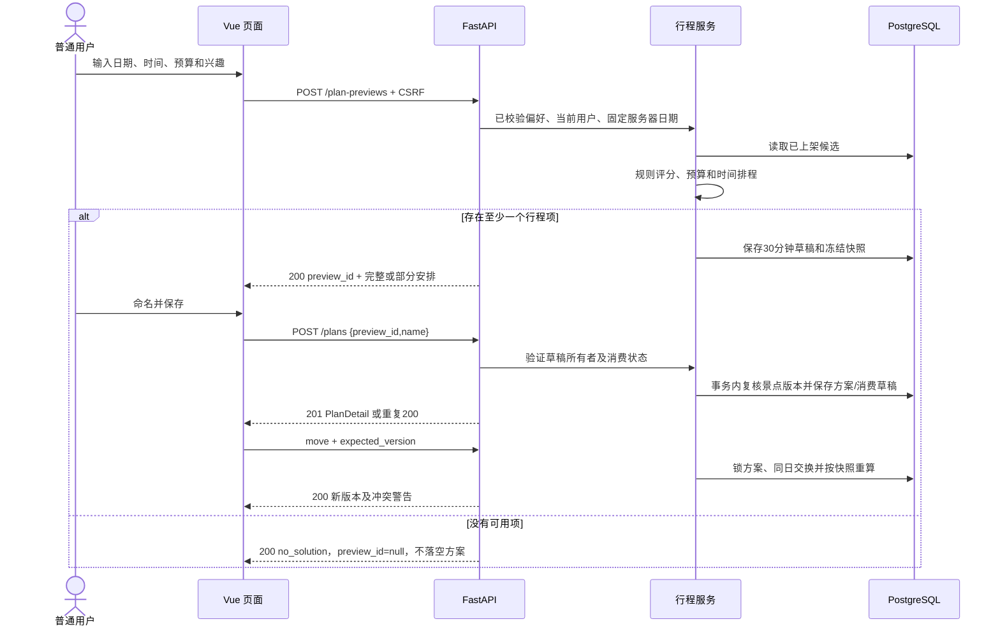

# 智游北京——接口设计

> 文档版本：1.0　｜　设计日期：2026-10-03　｜　状态：待实现的接口契约  
> 适用范围：高级软件工程课程项目、本机运行与演示。本文描述目标行为，不表示接口已经实现或通过测试。  
> 需求依据：[需求规格说明书](../requirements/requirements.md)、[用户故事](../requirements/user-stories.md)、[验收标准](../requirements/acceptance-criteria.md)、[决策记录](../requirements/open-questions.md)。总体方案、数据结构和模块职责分别见 [architecture](./architecture.md)、[data-design](./data-design.md)、[module-design](./module-design.md)。

## 1. 设计范围与原则

接口采用 HTTP + JSON，后端为 FastAPI / Pydantic 2，围绕账号、景点、收藏、行程、模拟预约、评价及后台管理划分路由。接口层只处理协议、校验、身份和响应转换；业务规则由应用服务统一执行，数据库约束负责兜底并发唯一性。

Must 接口组成课程 MVP；Should 接口按时间实现并记录验收状态；Could 接口保留扩展契约。没有真实支付、库存、实名、管理员代预约、账号封禁、文件上传或实时路线接口。导航链接属于 Must，嵌入式地图属于 Should；以需求 FR-POI-008、DEC-027 的明确结论为准。

本设计补充的技术默认值包括：会话有效期 8 小时、预览有效期 30 分钟、默认分页 20 条、最大单页 100 条、方案名称 1～50 字符、建议游玩时长 1～720 分钟、输入金额上限 99,999,999.99 元。这些值用于形成可实现契约，不属于新增旅游业务要求；变更时应同步四份架构文档与接口模型。

## 2. 通用协议约定

### 2.1 地址与数据格式

| 项目 | 约定 |
| --- | --- |
| API 前缀 | `/api/v1`；后文路由均相对此前缀，健康检查除外 |
| 开发访问 | 浏览器访问 `http://localhost:5173`，Vite 将 `/api` 代理到 `http://localhost:8000` |
| 演示访问 | 前端构建文件由 FastAPI 提供，浏览器访问 `http://localhost:8000`，API 同源 |
| 请求与响应 | UTF-8 JSON；字段为 `snake_case`；成功直接返回资源或分页对象，不再包一层 `code/data` |
| 资源 ID | UUID 字符串，如 `f536158b-b1f9-4a03-97c8-cf95b06bca68`；非法 UUID 返回 422 |
| 金额 | 十进制字符串，如 `"60.00"`；输入接受 `"60"`、`"60.0"`、`"60.00"`，最多两位小数；拒绝负数、指数、NaN、超过上限及三位小数；禁止静默四舍五入 |
| 金额运算 | 后端使用 Decimal；响应金额统一两位小数。票价、预算上限为 99,999,999.99；预约总额是票价乘人数，可超过单价上限 |
| 记录时间 | `created_at/updated_at/expires_at/cancelled_at/deleted_at` 为 UTC ISO 8601，例如 `2026-10-03T01:00:00Z` |
| 业务日期 | `YYYY-MM-DD`，以 `Asia/Shanghai` 为准。每次请求开始时捕获一次时钟，整次请求使用同一个 `server_date` |
| 输入时段 | `HH:mm`，精确到分钟；`daily_start < daily_end`，不支持输入跨夜每日时段；开放时间同样是单日单段 |
| 行程预计时刻 | `scheduled_start/scheduled_end` 为完整 ISO 8601、明确携带 `+08:00`。手工调整超过午夜时保留次日日期，不用 `HH:mm` 截断 |
| JSON 校验 | 请求对象拒绝未知字段；整数拒绝布尔值、浮点数和数值字符串；查询参数通过显式解析校验。评论/简介按纯文本返回，前端不使用原始 HTML 渲染 |
| 空值 | 允许缺省与允许 `null` 分别定义；必填字段不得以 `null` 代替；空列表使用 `[]` |
| 请求追踪 | 响应头 `X-Request-ID`；错误体携带相同 `request_id`；后端生成或校验后采用请求标识 |

### 2.2 分页、筛选和排序

所有可增长的列表都接受 `page`（整数，默认 1，最小 1）和 `page_size`（整数，默认 20，范围 1～100）。不设收藏、方案、预约的业务总量上限。越过最后一页返回 `items: []` 和真实 `total`，不是 404。

```json
{
  "items": [],
  "page": 1,
  "page_size": 20,
  "total": 0
}
```

同一请求的 `total` 与 `items` 使用同一筛选条件。景点默认 `base_popularity DESC, id ASC`；个人与后台记录默认 `created_at DESC, id ASC`。Should 景点排序允许 `popularity_desc`、`rating_desc`、`price_asc`、`price_desc`，最后均按 `id ASC` 稳定排序，评分为 `null` 的记录排在评分排序末尾。分页不承诺跨请求隔离并发新增，前端应在写操作后刷新当前列表。

搜索关键词在首尾去空格后匹配 `name OR description`，英文字母大小写不敏感。分类、价格、标签与关键词等维度取 AND；多个标签使用重复参数，例如 `tag_codes=history&tag_codes=architecture`，要求景点同时包含所有选中标签。推荐的兴趣匹配按匹配比例评分，不采用筛选时的“必须包含全部标签”规则。

### 2.3 固定词表

| 分类代码 | 中文名称 | 标签代码 | 中文名称 |
| --- | --- | --- | --- |
| `historical` | 历史古迹 | `history` | 历史 |
| `museum` | 博物展览 | `architecture` | 建筑 |
| `nature` | 自然风光 | `nature` | 自然 |
| `landmark` | 城市地标 | `culture` | 文化 |
| `theme_park` | 主题乐园 | `art` | 艺术 |
| `arts` | 文化艺术 | `family` | 亲子 |
| — | — | `photography` | 摄影 |
| — | — | `leisure` | 休闲 |
| — | — | `food` | 美食 |

其他枚举：`role=user/admin`；景点 `status=published/unpublished`；预约 `slot=morning/afternoon/full_day`；预约有效状态 `pending/completed/cancelled`；评价 `visibility=visible/hidden`；移动方向 `up/down`；生成结果 `complete/partial/no_solution`。中文展示名称从 `/meta` 获取，前端不自行创建新代码。

## 3. 身份、角色与错误契约

### 3.1 会话及 CSRF

1. 登录成功产生 32 个密码学随机字节的会话凭据，编码为 cookie `session_id`。数据库保存凭据摘要，不保存可直接使用的会话 cookie；会话为固定 8 小时有效期，不做滚动续期。
2. Cookie 使用 `HttpOnly; SameSite=Lax; Path=/`，本机 HTTP 演示 `Secure=false`，不设置宽泛 Domain。浏览器请求同源 API，前端不把会话凭据存入 localStorage。
3. 登录响应和 `GET /auth/me` 返回当前会话的随机 `csrf_token`，前端仅保存在内存。所有登录态写请求携带 `X-CSRF-Token`。重新登录建立新会话，退出撤销当前会话并清除 cookie。
4. 所有 POST/PUT/PATCH/DELETE 都校验 `Origin` 必须与允许配置精确匹配：开发为 `http://localhost:5173`，演示为 `http://localhost:8000`。缺失、`null` 或未允许 Origin 返回 403。除无请求体 DELETE 外，写请求必须为 `Content-Type: application/json`；无业务字段的 POST/PUT 提交 `{}`，错误媒体类型返回 415。
5. 注册和登录不要求已有 CSRF token，以 Origin + JSON 校验防止登录 CSRF。退出无有效会话时仍校验 Origin 和 JSON，返回 204；若有有效会话，还须校验 CSRF。接口调试工具也须发送相应头部。
6. 开发使用 Vite 同源代理，不依赖开放 CORS。若启用直接跨源调试，仅允许明确 Origin 并允许 credentials，禁止通配 Origin。

权限定义：`public` 表示游客及已登录角色都可读；`authenticated` 表示 `user/admin` 会话；`user` 表示仅普通用户的个人能力；`admin` 表示仅管理员。个人资源的所有者来自当前会话，客户端不得提交或修改 `user_id`。管理员只能使用后台只读预约查询，不能通过个人接口发起、取消预约或评价；本设计也不向管理员开放个人收藏和方案接口。

### 3.2 通用状态码

| HTTP | 含义 | 典型 `error.code` |
| --- | --- | --- |
| 200 | 查询、更新、幂等命中成功 | — |
| 201 | 新资源创建成功；具有稳定详情查询路径的资源创建返回 `Location` | — |
| 204 | 退出/删除成功；没有响应体 | — |
| 401 | 没有有效会话或登录凭据错误 | `AUTH_REQUIRED`、`INVALID_CREDENTIALS` |
| 403 | 角色不允许、Origin 或 CSRF 错误 | `FORBIDDEN`、`ORIGIN_NOT_ALLOWED`、`CSRF_INVALID` |
| 404 | 资源不存在、公开访问下架景点、访问他人资源 | `RESOURCE_NOT_FOUND` |
| 409 | 合法输入与当前业务状态冲突 | `USERNAME_TAKEN`、`VERSION_CONFLICT` 等 |
| 415 | 写请求不满足 JSON 媒体类型 | `UNSUPPORTED_MEDIA_TYPE` |
| 422 | 缺失、未知、类型或取值不合法 | `VALIDATION_ERROR` |
| 503 | 数据库等必要依赖不可用或生成超时 | `DEPENDENCY_UNAVAILABLE`、`PLAN_GENERATION_TIMEOUT` |
| 500 | 未预期内部错误 | `INTERNAL_ERROR` |

```json
{
  "error": {
    "code": "VALIDATION_ERROR",
    "message": "请求参数不符合要求",
    "details": [
      {"field": "people_count", "message": "预约人数应为 1～10 的整数"}
    ],
    "request_id": "a535060e-7c60-4781-b7a1-697769a18010"
  }
}
```

`details` 始终为数组；没有字段定位时为 `[]`；嵌套字段用 `opening_hours.0.opens_at` 等路径，查询字段使用其参数名。错误提示使用中文，不暴露 SQL、密码摘要、堆栈或资源所有者。先检查有效会话和角色，再用 `id + current_user_id` 查个人资源；他人资源与不存在资源统一 404。登录错误统一“用户名或密码错误”，不区分账号是否存在。Pydantic 的原始校验异常由统一处理器转换为上述格式。

## 4. 接口总览与需求追踪

| 方法与路径 | 权限 | 成功码 | 优先级 | 主要需求 |
| --- | --- | --- | --- | --- |
| `GET /meta` | public | 200 | Must 支撑 | FR-POI-003、FR-PLAN-002 |
| `POST /auth/register` | public | 201 | Must | FR-AUTH-001～002 |
| `POST /auth/login` | public | 200 | Must | FR-AUTH-003 |
| `GET /auth/me` | authenticated | 200 | Must 支撑 | FR-AUTH-005 |
| `POST /auth/logout` | public，见会话规则 | 204 | Must | FR-AUTH-004 |
| `GET /attractions` | public | 200 | Must；排序 Should | FR-POI-001～004、006～007 |
| `GET /attractions/{id}` | public | 200 | Must | FR-POI-005、008 |
| `GET /attractions/{id}/reviews` | public | 200 | Must | FR-REV-001、008 |
| `GET /favorites` | user | 200 | Must | FR-FAV-003 |
| `PUT /favorites/{attraction_id}` | user | 200/201 | Must | FR-FAV-001 |
| `DELETE /favorites/{attraction_id}` | user | 204 | Must | FR-FAV-002 |
| `POST /plan-previews` | user | 200 | Must | FR-PLAN-001～006 |
| `POST /plans` | user | 201/200 | Must | FR-PLAN-007 |
| `GET /plans`、`GET /plans/{id}` | user | 200 | Must | FR-PLAN-008 |
| `POST /plans/{id}/items/{item_id}/move` | user | 200 | Must | FR-PLAN-008、012 |
| `DELETE /plans/{id}/items/{item_id}` | user | 200 | Must | FR-PLAN-008、012 |
| `PATCH /plans/{id}`、`DELETE /plans/{id}` | user | 200/204 | Should | FR-PLAN-009 |
| `POST /plans/{id}/copy` | user | 201 | Could | FR-PLAN-010 |
| `POST /bookings` | user | 201 | Must | FR-BOOK-001～003、007 |
| `GET /bookings`、`GET /bookings/{id}` | user | 200 | Must | FR-BOOK-004 |
| `POST /bookings/{id}/cancel` | user | 200 | Must | FR-BOOK-005～006 |
| `POST /reviews` | user | 201 | Must | FR-REV-002～004 |
| `GET /reviews`、`DELETE /reviews/{id}` | user | 200/204 | Must | FR-REV-005～006 |
| `GET /admin/attractions`、`GET /admin/attractions/{id}` | admin | 200 | Must | FR-ADM-002 |
| `POST /admin/attractions`、`PATCH /admin/attractions/{id}` | admin | 201/200 | Must | FR-ADM-002～003 |
| `PATCH /admin/attractions/{id}/status` | admin | 200 | Must | FR-ADM-004 |
| `GET /admin/bookings` | admin | 200 | Must | FR-ADM-005 |
| `GET /admin/reviews` | admin | 200 | Must | FR-ADM-006 |
| `PATCH /admin/reviews/{id}/visibility` | admin | 200 | Must | FR-REV-007～008 |
| `GET /admin/statistics` | admin | 200 | Should | FR-ADM-007～008 |
| `GET /health/live`、`GET /health/ready` | public，前缀外 | 200/503 | 技术支撑 | NFR-REL-001 |

## 5. 共享响应模型

以下字段集合用于后续端点。标为可空的字段仍在响应中出现；只读字段不接受客户端赋值。响应模型与持久化实体分离，避免内部字段泄露；FastAPI 的响应模型用于文档、序列化和输出字段限制，具体能力见 [官方响应模型说明](https://fastapi.tiangolo.com/tutorial/response-model/)。

### 5.1 User 与景点模型

| 模型 | 字段 |
| --- | --- |
| `User` | `id: UUID`、`username: string`（首尾去空格后的显示名）、`role: user/admin`、`created_at: UTC timestamp` |
| `OpeningHour` | `weekday: int(1..7)`（周一到周日）、`is_open: bool`、`opens_at: HH:mm/null`、`closes_at: HH:mm/null`；关闭时两时间必须 null，开放时都必填且前者早于后者 |
| `AttractionSummary` | `id`、`name`、`category_code`、`image_url`、`ticket_price: money`、`tag_codes: string[]`、`base_popularity: int`、`rating: number/null`、`rating_count: int` |
| `AttractionDetail` | 摘要字段，以及 `description`、`image_source`、`image_license`、`address`、`latitude: number`、`longitude: number`、`coordinate_system: "WGS84"`、`opening_hours: OpeningHour[7]`、`duration_minutes: int`、`booking_slots: string[]`、`navigation_url: string`、`map_position_url: string/null`、`map_notice: string/null`、`status`、`version: int`、`created_at`、`updated_at` |
| `Favorite` | `attraction_id`、`created_at`、`attraction: AttractionSummary`、`status: published/unpublished`、`current_available: bool` |
| `AttractionSnapshot` | `schema_version: 1`、`attraction_version`、`name`、`category_code`、`description`、`image_url`、`image_source`、`image_license`、`address`、`latitude`、`longitude`、`coordinate_system: "WGS84"`、`opening_hours`、`duration_minutes`、`ticket_price`、`tag_codes`、`base_popularity`、`booking_slots`；保存当时字段，后续不随景点更新 |
| `BookingSnapshot` | `schema_version: 1`、`attraction_version`、`name`、`address`、`ticket_price: money`、`slot`；预约时必要信息的轻量快照，关联景点ID位于 Booking 外层 |

没有可见且未删除评价时 `rating=null`、`rating_count=0`，不能以 0 分冒充实际评分。平均分仅按当前可见且未删除评价计算，响应保留两位小数；评分排序和统计使用同一公开口径。快照不包含实时评分与导航供应商 URL；导航由坐标经 MapAdapter 生成。

### 5.2 行程模型

| 模型 | 字段与含义 |
| --- | --- |
| `PlanPreferences` | `start_date`、`days: int(1..7)`、`daily_start`、`daily_end`、`budget: money`、`tag_codes: string[]` |
| `Warning` | `code: string`、`message: string`、`day_index: int/null`、`item_id: UUID/null`；属于生成或某日/项的原因和冲突说明 |
| `PlanItem` | `id`、`attraction_id`、`sequence: int(从1连续)`、`attraction_snapshot`、`scheduled_start`、`scheduled_end`、`travel_minutes: int`（从前一项到本项，首项为0）、`cost: money`、`reasons: string[]`、`current_available: bool`、`warnings: Warning[]` |
| `PlanDay` | `day_index: int(从1连续)`、`date`、`total_cost: money`、`total_duration_minutes: int`（从每日开始到最后一项结束，含等待和交通；空日0）、`items: PlanItem[]`、`warnings: Warning[]` |
| `PlanPreview` | `preview_id: UUID/null`、`expires_at: UTC timestamp/null`、`result_status`、`preferences: PlanPreferences`、`total_cost: money`、`day_plans: PlanDay[]`、`warnings: Warning[]`、`server_date`、`timezone: "Asia/Shanghai"` |
| `PlanSummary` | `id`、`name`、`start_date`、`days`、`total_cost`、`item_count`、`version`、`created_at`、`updated_at` |
| `PlanDetail` | 摘要字段，以及 `daily_start`、`daily_end`、`budget`、`tag_codes`、`day_plans`、`warnings` |

预览阶段的 item ID 可作为草稿内部标识；首次保存生成最终计划项 ID，返回的 `PlanDetail` 为后续编辑的唯一依据。预览非空才落库；无结果仍返回全部输入日期对应的空日和中文原因，`preview_id/expires_at=null`。

| 警告代码 | 含义 |
| --- | --- |
| `NO_PUBLISHED_ATTRACTIONS` | 没有已上架候选 |
| `BUDGET_LIMIT` | 剩余预算无法容纳候选 |
| `TIME_LIMIT` | 当日关闭、开放窗口或每日时间容量不足，具体原因写入 message |
| `CANDIDATES_EXHAUSTED` | 未重复使用的候选不足 |
| `OPENING_TIME_CONFLICT` | 手工调整的时段与快照开放时间冲突 |
| `DAILY_TIME_EXCEEDED` | 手工调整超过每日可用时间 |
| `DAY_OVERFLOW` | 手工调整的预计时刻进入下一日 |
| `ATTRACTION_UNAVAILABLE` | 已保存项对应景点当前下架，作为历史展示诊断 |

`complete` 定义为每个游玩日至少有一项；`partial` 定义为至少有一项且至少有一个空日；`no_solution` 表示零项。不把空闲时间误判为失败，也不承诺贪心结果为全局最优。非空结果照样可以返回 `BUDGET_LIMIT` 等停排原因；这些原因不会使 HTTP 变为失败。费用只是一人参考门票之和，预约人数与行程预算分别处理。

### 5.3 预约、评价与后台模型

| 模型 | 字段 |
| --- | --- |
| `Booking` | `id`、`booking_number`、`attraction_id`、`attraction_snapshot: BookingSnapshot`、`visit_date`、`slot`、`people_count`、`ticket_price: money`（预约时单价）、`total_amount: money`、`status`（有效状态）、`cancelled_at: timestamp/null`、`can_cancel: bool`、`can_review: bool`、`has_review: bool`（包括隐藏/逻辑删除）、`created_at` |
| `PublicReview` | `id`、`author_name`、`rating: int`、`content`、`created_at`；不返回 booking_id、用户ID或隐藏状态 |
| `OwnReview` | `id`、`booking_id`、`attraction_id`、`attraction_name`、`rating`、`content`、`visibility`、`created_at` |
| `AdminBooking` | `Booking` 字段中省略 `can_cancel/can_review`，增加 `user: {id, username}`；后台不提供任何预约写操作 |
| `AdminReview` | `OwnReview` 字段，以及 `user: {id, username}`、`deleted_at: timestamp/null` |

预约有效状态：`cancelled_at != null` 为 cancelled，否则 `visit_date < server_date` 为 completed，否则 pending。`can_cancel` 必须未取消且 `visit_date > server_date`；今天的 pending 预约不能取消。`can_review` 必须未取消、日期已过且该预约从未创建过评价；景点下架不撤销历史预约评价资格。

## 6. 基础信息与账号接口

### 6.1 `GET /meta`

返回固定词表及服务器规则，支持前端渲染选项和输入边界。每次调用返回当前 `server_date`，仅供提示，写接口仍独立校验。

```json
{
  "server_date": "2026-10-03",
  "timezone": "Asia/Shanghai",
  "coordinate_system": "WGS84",
  "categories": [
    {"code": "historical", "name": "历史古迹"},
    {"code": "museum", "name": "博物展览"},
    {"code": "nature", "name": "自然风光"},
    {"code": "landmark", "name": "城市地标"},
    {"code": "theme_park", "name": "主题乐园"},
    {"code": "arts", "name": "文化艺术"}
  ],
  "tags": [
    {"code": "history", "name": "历史"},
    {"code": "architecture", "name": "建筑"},
    {"code": "nature", "name": "自然"},
    {"code": "culture", "name": "文化"},
    {"code": "art", "name": "艺术"},
    {"code": "family", "name": "亲子"},
    {"code": "photography", "name": "摄影"},
    {"code": "leisure", "name": "休闲"},
    {"code": "food", "name": "美食"}
  ],
  "booking_slots": [
    {"code": "morning", "name": "上午"},
    {"code": "afternoon", "name": "下午"},
    {"code": "full_day", "name": "全天"}
  ],
  "rules": {
    "username_min_length": 3,
    "username_max_length": 20,
    "password_min_length": 8,
    "password_max_length": 64,
    "plan_days_min": 1,
    "plan_days_max": 7,
    "plan_name_max_length": 50,
    "booking_max_days_ahead": 90,
    "people_count_min": 1,
    "people_count_max": 10,
    "review_content_min_length": 5,
    "review_content_max_length": 500,
    "money_input_max": "99999999.99",
    "preview_ttl_minutes": 30,
    "page_size_default": 20,
    "page_size_max": 100
  },
  "data_notice": "课程演示数据及参考价格不代表实时官方信息；预约不产生真实交易。",
  "transport_notice": "交通时间按直线距离估算，仅供规划参考，不代表实时路线。"
}
```

### 6.2 注册、登录、身份与退出

| 接口 | 请求 | 成功响应 | 业务错误 |
| --- | --- | --- | --- |
| `POST /auth/register` | `{"username":"旅行同学","password":"example-pass-2026"}`；两字段必填 | 201 `User`；角色由服务器固定 user；不自动建立会话 | 422 字段无效；409 `USERNAME_TAKEN` |
| `POST /auth/login` | 同上；凭据必填 | 200 `{"user": User, "csrf_token": string, "expires_at": timestamp}`，设置 cookie | 401 `INVALID_CREDENTIALS` |
| `GET /auth/me` | 无参数 | 同登录 JSON；不续期、不返回 session_id | 401 `AUTH_REQUIRED` |
| `POST /auth/logout` | `{}`；会话存在时携带 CSRF | 204，撤销当前会话并清 cookie；无有效会话也是204 | 403 Origin/有效会话的 CSRF 校验失败 |

用户名只去首尾空格，再验证中文、英文字母、数字或下划线，3～20 Unicode 字符；判重键仅对 ASCII 英文字母转小写。密码原文按 8～64 字符校验，既不 trim 也不截断，使用 Argon2id 摘要保存。公开请求不能传 role；管理员仅由种子初始化产生。注册唯一性还须由数据库约束保障，不能仅用“先查后插”。

## 7. 景点与收藏接口

### 7.1 景点检索与详情

`GET /attractions` 查询参数：

| 参数 | 约束/默认 |
| --- | --- |
| `keyword` | 可选，首尾去空格后 0～100 字符；空串等同无条件 |
| `category_code` | 可选，固定分类之一 |
| `price_min`、`price_max` | 可选 money；包含边界；两者都传时 min ≤ max |
| `tag_codes` | 可选重复参数，固定标签，不允许未知词条；重复同标签去重 |
| `sort` | 可选，默认 popularity_desc；其他枚举属于 Should |
| `page`、`page_size` | 通用分页 |

返回 200 `Page<AttractionSummary>`，始终只含 published；没有匹配为正常空页。`GET /attractions/{id}` 返回 200 `AttractionDetail`，不存在或下架均 404。`GET /attractions/{id}/reviews` 接受分页，返回 200 `Page<PublicReview>`，仅 visible 且未删除；其父景点必须 published，否则 404。

详情 `navigation_url` 通过 MapAdapter 使用 WGS84 经纬度生成。默认导航方案采用官方 Google Maps directions URL，例如 `https://www.google.com/maps/dir/?api=1&destination=39.9163%2C116.3972&travelmode=transit`；来源见 [Google Maps URL 官方说明](https://developers.google.com/maps/documentation/urls/get-started)。没有起点参数时由外部地图处理起点选择，站内不提供实时路线；外部供应商可替换，不要求本项目拥有地图密钥。`map_position_url` 可按官方高德 URI 协议并指定 `coordinate=wgs84` 生成位置标记，协议见 [高德点标记说明](https://lbs.amap.com/api/uri-api/guide/mobile-web/point)；位置标记不能替代导航入口。外部导航在演示网络可用性须实测，不保证供应商可达；失败时显示地址与经纬度及中文提示，站内页面继续可用，不把地图不可达转换为整个详情 503。

### 7.2 收藏

| 接口 | 请求/成功响应 | 规则及错误 |
| --- | --- | --- |
| `GET /favorites` | 通用分页；200 `Page<Favorite>` | 仅当前用户；下架景点仍列出状态，可取消但不能进入新的预约入口 |
| `PUT /favorites/{attraction_id}` | `{}`；首次201 `Favorite`，已收藏200同记录 | 已存在优先幂等返回；未收藏的下架/不存在景点404；数据库(user_id, attraction_id)唯一 |
| `DELETE /favorites/{attraction_id}` | 无请求体；204 | 只删除当前用户的该关系；关系不存在也204；景点下架不妨碍取消 |

用户 ID 不出现在收藏路径和请求体中；不存在“读取其他用户收藏”的接口。收藏列表的当前信息可更新，不属于历史冻结快照。

## 8. 行程生成、保存与调整接口

### 8.1 `POST /plan-previews`

请求所有字段必填，标签数组至少一项且代码有效；重复标签去重。服务器开始日期不得早于当前日期，天数 1～7，每日结束晚于开始，预算非负且满足金额精度。具体评分、预算/开放/交通约束由 [module-design](./module-design.md) 的规则引擎执行；预置 20～30 景点范围内同步生成。设计采用请求总 deadline 5 秒：在计算阶段检查剩余时间，并为数据库写入、回滚和响应预留预算（建议计算及候选读取至多4秒，其余预算用于收尾）；数据库查询/锁等待使用剩余预算作为超时上限。无法在 deadline 内完成时，应在5秒内返回503 `PLAN_GENERATION_TIMEOUT`，不保存半成品草稿。实际耗时须后续在记录的课程环境验证。

```json
{
  "start_date": "2026-10-04",
  "days": 2,
  "daily_start": "09:00",
  "daily_end": "17:00",
  "budget": "200.00",
  "tag_codes": ["history", "architecture"]
}
```

成功 200 `PlanPreview`。非空结果在服务端暂存输入、景点版本和冻结快照 30 分钟；前端展示草稿，不回传任意景点/费用作为保存依据。空结果为正常 200 `no_solution`，不创建草稿和正式方案。推荐理由至少一条，交通时间首项0，其余按 `ceil((直线距离/20km/h×60+15)/5)×5` 分钟计算；使用种子坐标，没有实时路况或酒店出发地。

### 8.2 `POST /plans`

请求 `{"preview_id":"UUID","name":"北京历史建筑两日游"}`；name 首尾去空格后 1～50 字符。优先验证当前用户是草稿所有者，否则 404。保存行为：

1. 如果该草稿已经对应一份仍存在的方案，直接返回同一方案 200，即使草稿已到期；不重新覆盖名称或内容。
2. 如果草稿 `consumed_at` 已设置且原方案已删除，返回 409 `PREVIEW_ALREADY_USED`，不能重新消费复活。
3. 未消费草稿校验未过期、非空、出行日期尚未过去，并重新校验使用景点仍 published 且版本与生成时相同。失败分别返回 409 `PREVIEW_EXPIRED`、`PLAN_DATE_PASSED`、`PREVIEW_STALE`，提示重新生成。
4. 一个事务内创建方案、全部行程项并标记草稿消费，首次201 `PlanDetail` + `Location: /api/v1/plans/{id}`。并发同草稿保存由数据库唯一约束及消费锁保证只生成一份。

非空部分方案允许保存。请求不接受 `user_id/day_plans/total_cost`，防止篡改报价或保存他人景点安排。首次保存 `version=1`。

### 8.3 查看与修改

| 接口 | 请求 | 成功响应与规则 | 409 业务错误 |
| --- | --- | --- | --- |
| `GET /plans` | 通用分页 | 200 `Page<PlanSummary>`，只含本人 | — |
| `GET /plans/{id}` | 无 | 200 `PlanDetail`，历史快照仍可查看 | — |
| `PATCH /plans/{id}`（Should） | `{"name":"新名称","expected_version":1}` | 200完整 `PlanDetail`，版本递增 | `VERSION_CONFLICT` |
| `DELETE /plans/{id}`（Should） | 查询 `expected_version=1`，无请求体 | 204，方案及行程项不再可见；消费墓碑保留 | `VERSION_CONFLICT` |
| `POST /plans/{id}/items/{item_id}/move` | `{"direction":"up","expected_version":1}` | 200完整 `PlanDetail`，同日相邻交换、连续重编号、重算并增版本 | `VERSION_CONFLICT`、`MOVE_BOUNDARY` |
| `DELETE /plans/{id}/items/{item_id}` | 查询 `expected_version=1`，无请求体 | 200完整 `PlanDetail`，删除项并重算、增版本；允许删除至全空 | `VERSION_CONFLICT` |
| `POST /plans/{id}/copy`（Could） | `{"name":"复制后的方案名称"}` | 201独立 `PlanDetail`，新方案/项ID、version=1；保留冻结内容与原日期，不复用消费草稿 | — |

所有 `expected_version` 均必填整数≥1；实际版本不同返回 409，并在 details 给出当前版本提示客户端刷新，不能静默覆盖。角色错误403，资源不存在、已整份删除、他人方案，或 item 不属于该方案均404。首项上移/末项下移返回 `MOVE_BOUNDARY`，不改变内容和版本。不提供跨天移动或添加任意景点。

重算使用冻结景点价格、坐标、建议时长和星期开放时间：依次计算交通、等待、预计开始/结束及费用。存在开放/每日容量/跨午夜冲突仍持久化调整并200，警告放在相关 item/day；不得把合法手工调整直接422拒绝。今日以后景点资料变化不替换历史快照；读取时增加 current_available 和 `ATTRACTION_UNAVAILABLE` 诊断，但不修改方案版本或历史费用。手动删空是已保存方案的编辑结果，与“禁止保存空生成草稿”不冲突。

### 8.4 编辑响应示意

以下为 `PlanDetail.day_plans` 中单项的完整结构示例，其余顶层字段按共享模型返回；示例数据为课程占位数据，不表示实际景点时段。

```json
{
  "id": "c0bd7428-f3df-48e2-8a65-9a46732f115e",
  "attraction_id": "f536158b-b1f9-4a03-97c8-cf95b06bca68",
  "sequence": 1,
  "attraction_snapshot": {
    "schema_version": 1,
    "attraction_version": 1,
    "name": "课程示例历史景点",
    "category_code": "historical",
    "description": "用于演示行程规则的种子数据。",
    "image_url": "/assets/attractions/example.svg",
    "image_source": "小组原创占位图",
    "image_license": "项目演示授权",
    "address": "北京市课程示例地址",
    "latitude": 39.9163,
    "longitude": 116.3972,
    "coordinate_system": "WGS84",
    "opening_hours": [
      {"weekday": 1, "is_open": false, "opens_at": null, "closes_at": null},
      {"weekday": 2, "is_open": true, "opens_at": "08:30", "closes_at": "17:00"},
      {"weekday": 3, "is_open": true, "opens_at": "08:30", "closes_at": "17:00"},
      {"weekday": 4, "is_open": true, "opens_at": "08:30", "closes_at": "17:00"},
      {"weekday": 5, "is_open": true, "opens_at": "08:30", "closes_at": "17:00"},
      {"weekday": 6, "is_open": true, "opens_at": "08:30", "closes_at": "17:00"},
      {"weekday": 7, "is_open": true, "opens_at": "08:30", "closes_at": "17:00"}
    ],
    "duration_minutes": 180,
    "ticket_price": "60.00",
    "tag_codes": ["history", "architecture"],
    "base_popularity": 90,
    "booking_slots": ["morning", "afternoon", "full_day"]
  },
  "scheduled_start": "2026-10-04T09:00:00+08:00",
  "scheduled_end": "2026-10-04T12:00:00+08:00",
  "travel_minutes": 0,
  "cost": "60.00",
  "reasons": ["匹配历史与建筑兴趣，参考票价在剩余预算内"],
  "current_available": true,
  "warnings": []
}
```

## 9. 模拟预约接口

### 9.1 创建与查询

`POST /bookings` 请求：

```json
{
  "attraction_id": "f536158b-b1f9-4a03-97c8-cf95b06bca68",
  "visit_date": "2026-10-04",
  "slot": "morning",
  "people_count": 2
}
```

成功201 `Booking`；`booking_number` 为 `BJ-` + 本条预约 ID 的 32 位大写 UUID 十六进制，如预约ID为 `f536158b-b1f9-4a03-97c8-cf95b06bca68` 时编号为 `BJ-F536158BB1F94A0397C8CF95B06BCA68`，并保持唯一约束。服务器记录创建当时快照、单价和 `total_amount=单价×人数`，不接受客户端提交金额或状态。

| 检查 | 结果 |
| --- | --- |
| 日期不在 `[server_date, server_date+90天]` | 422，定位 visit_date |
| 人数不是1～10整数或场次代码不属于固定词表 | 422，定位对应字段 |
| 景点不存在或已下架 | 404 |
| 固定词表内的场次未被该景点支持 | 422，定位 slot |
| 同用户+景点+日期+场次已有未取消预约 | 409 `DUPLICATE_BOOKING` |

预约不另行检查真实库存或节假日开放，也不因推荐营业日规则而新增预约拒绝条件；本项目只模拟需求明确规定的日期、场次、人数和重复预约规则。同一用户重复提交不会隐式改变原人数；取消原记录后可重新创建新的预约。预约与快照创建是一个事务，并发重复提交最多一个成功。

`GET /bookings` 接受分页及可选 `status`（有效状态）和 `visit_date`，返回200 `Page<Booking>`；`GET /bookings/{id}` 返回200 `Booking`。仅查询本人；查询时用同一 server_date 推导状态与动作权限，下架景点仍显示快照。

### 9.2 `POST /bookings/{id}/cancel`

请求 `{}`，成功200更新后的 `Booking`。当前用户为所有者、尚未取消且 `visit_date > server_date` 才可取消；写 cancelled_at 时锁定该记录，避免重复并发更新。下架不阻止符合日期规则的取消。

- 已取消：409 `BOOKING_ALREADY_CANCELLED`；重复操作不改变 cancelled_at。
- 预约是今天或日期已过：409 `BOOKING_CANCELLATION_CLOSED`。今天状态仍为 pending，但取消窗口已经关闭。
- 记录不属于本人或不存在：404；管理员使用此个人接口403。

取消不会产生退款、支付回调或库存回补。

## 10. 评价接口

| 接口 | 请求 | 成功与规则 | 业务错误 |
| --- | --- | --- | --- |
| `POST /reviews` | `{"booking_id":"UUID","rating":5,"content":"历史建筑很有特色，建议预留充足时间。"}` | 201 `OwnReview`；user/attraction由预约推导；初始 visible | 他人/不存在预约404；未完成或取消409 `REVIEW_NOT_ALLOWED`；预约终身已评409 `REVIEW_ALREADY_EXISTS` |
| `GET /reviews` | 通用分页 | 200 `Page<OwnReview>`，包含本人 hidden，排除本人逻辑删除 | 通用权限错误 |
| `DELETE /reviews/{id}` | 无请求体 | 204，逻辑删除；本人同一记录重复删除仍204 | 他人/从未存在记录404 |

rating 必须为 1～5 的严格整数；content 首尾去空格后 5～500 个 Unicode 字符，全部空白拒绝422。一次评价对应一个 completed 且未取消的本人预约，景点后来下架也可评。数据库 booking_id 保持终身唯一，隐藏或逻辑删除后不能对同一预约再次发表。删除不物理移除记录，公开查询和均分立即排除；管理员不能恢复。平均分通过可见未删除评价聚合获得，不由客户端上报或写入独立可信分数。

## 11. 后台管理接口

### 11.1 景点管理

`GET /admin/attractions` 接受公共搜索/价格/标签/排序参数、分页，以及可选 `status`，返回 `Page<AttractionDetail>`，包含上下架记录；`GET /admin/attractions/{id}` 返回 `AttractionDetail`。后台返回导航和图片来源字段便于检查，不提供物理删除景点。

`POST /admin/attractions` 请求所有业务字段必填：

| 字段 | 校验与技术默认边界 |
| --- | --- |
| `name` | 首尾去空格后1～100字符 |
| `category_code` | 固定六类之一 |
| `description` | 首尾去空格后1～5000字符 |
| `image_url` | 本项目 `/assets/` 下相对路径或 HTTPS URL；禁 javascript/data/file 协议；不自动下载或抓取远程图片 |
| `image_source`、`image_license` | 首尾去空格后分别1～500、1～200字符，须记录开放许可或小组占位图来源 |
| `address` | 首尾去空格后1～200字符 |
| `latitude`、`longitude` | 有限 JSON number；纬度[-90,90]、经度[-180,180]，存储语义WGS84 |
| `opening_hours` | 恰好7条，weekday 1～7不重复不缺失；开放/关闭时间校验见共享模型；响应按weekday排序 |
| `duration_minutes` | 严格整数1～720 |
| `ticket_price` | money，0～99,999,999.99 |
| `tag_codes` | 至少一个固定标签，不能重复或含未知值 |
| `base_popularity` | 严格整数0～100 |
| `booking_slots` | 至少一个固定场次，不能重复或含未知值 |
| `status` | published/unpublished |

成功201 `AttractionDetail`、version=1。北京是种子数据范围，坐标合法性检查不等于自动认定景点属于北京；数据整理时人工核验。请求不存在创建任意分类、管理员账号或上传图片的能力。

`PATCH /admin/attractions/{id}` 请求为 `expected_version` 必填，外加至少一个需要修改的业务字段（不包括 status），例如：

```json
{
  "expected_version": 1,
  "ticket_price": "65.00",
  "tag_codes": ["history", "architecture", "culture"]
}
```

字段约束同创建；省略字段保持原值，显式null按字段规则校验。`opening_hours`、`tag_codes`、`booking_slots` 均整组原子替换，不提供数组局部下标修改。一次成功更新与关联词条写入同一事务，version递增，返回200完整 `AttractionDetail`。版本不一致409 `VERSION_CONFLICT`；非法字段422；不存在404。管理员不能修改聚合rating/rating_count或历史快照。

`PATCH /admin/attractions/{id}/status` 请求 `{"status":"unpublished","expected_version":2}`，成功200完整 `AttractionDetail`，发生状态变化时增version；若目标已是当前状态且版本一致，200返回原版本。下架使后续公共查询/生成/新预约不可使用该景点；已有收藏、方案和预约不级联删除，既有取消及评价资格不受其影响。重新上架使用同一接口。

### 11.2 预约、评价与统计

| 接口 | 查询或请求 | 成功响应与限制 |
| --- | --- | --- |
| `GET /admin/bookings` | 分页；可选 `visit_date`、`date_from`、`date_to`、`attraction_id`、`status`。指定visit_date时不同时指定range；from≤to | 200 `Page<AdminBooking>`，组合条件AND；状态按本次server_date推导；只读 |
| `GET /admin/reviews` | 分页；可选 `attraction_id`、`visibility`、`deleted`（bool；缺省返回全部，true仅已删，false仅未删） | 200 `Page<AdminReview>`，含隐藏/已删除供管理核对 |
| `PATCH /admin/reviews/{id}/visibility` | `{"visibility":"hidden"}` 或visible | 200 `AdminReview`；同目标状态幂等；记录锁保障与用户逻辑删并发一致；已被用户删除409 `REVIEW_DELETED` |
| `GET /admin/statistics`（Should） | 可选 `top_n` 整数1～30，默认10 | 200 `Statistics`，无写能力 |

`Statistics` 响应字段：

```json
{
  "server_date": "2026-10-03",
  "timezone": "Asia/Shanghai",
  "counts": {"users": 2, "attractions": 3, "bookings": 4, "plans": 1},
  "popular_attractions": [
    {
      "attraction_id": "f536158b-b1f9-4a03-97c8-cf95b06bca68",
      "name": "课程示例历史景点",
      "status": "published",
      "favorite_count": 2,
      "active_booking_count": 3,
      "popularity_score": 8,
      "base_popularity": 90
    }
  ],
  "interest_distribution": [
    {"tag_code": "history", "tag_name": "历史", "plan_count": 1},
    {"tag_code": "architecture", "tag_name": "建筑", "plan_count": 1},
    {"tag_code": "nature", "tag_name": "自然", "plan_count": 0},
    {"tag_code": "culture", "tag_name": "文化", "plan_count": 0},
    {"tag_code": "art", "tag_name": "艺术", "plan_count": 0},
    {"tag_code": "family", "tag_name": "亲子", "plan_count": 0},
    {"tag_code": "photography", "tag_name": "摄影", "plan_count": 0},
    {"tag_code": "leisure", "tag_name": "休闲", "plan_count": 0},
    {"tag_code": "food", "tag_name": "美食", "plan_count": 0}
  ]
}
```

统计口径：users为普通用户数，不包含预置admin；attractions含上下架；bookings含所有状态；plans为未整份删除的方案。热门排行含现存景点，`favorite_count + 2×未取消预约数`，已完成未取消同样计入，同分按基础热度降序、id升序。兴趣分布以现存保存方案的输入标签计数，每份方案每个标签计一次，返回全9标签，零值也返回；多标签总计可大于方案总数。一次统计请求用一致数据库快照避免数量相互矛盾。不存在用户画像或账号管理接口。

## 12. 健康检查与关键交互

### 12.1 健康检查（不使用 `/api/v1` 前缀）

- `GET /health/live`：进程能处理请求返回200 `{"status":"ok"}`，不访问外部地图。
- `GET /health/ready`：数据库可连接且所需表/迁移状态就绪返回200 `{"status":"ready"}`；必要依赖失败503统一 `DEPENDENCY_UNAVAILABLE`。地图服务不参与就绪判定。

### 12.2 生成—保存—调整



### 12.3 客户端处理约定

前端启动调用 `/meta` 与 `/auth/me`：me 401视为游客，不反复弹错误。登录后存内存CSRF，个人写请求附加该token；401引导重新登录、403提示权限、422定位表单字段、409显示中文业务原因，版本/草稿冲突提供刷新或重新生成入口。提交按钮在请求中禁用，预约失败不展示虚假的新记录。HTTP200中的 partial/no_solution/警告应作为业务结果显示，不能使用通用“请求失败”覆盖可解释内容。

页面根据响应使用 can_cancel/can_review/current_available显示操作，但最终权限和业务检查仍在服务端。调序成功后用整个 PlanDetail 替换页面状态，避免前端自行算金额或继续使用旧version。后台导航、公开导航和评价文字作为纯文本/受控链接渲染，来源与演示提示应可见。

## 13. 契约验证与实现交付

以本文件建立 FastAPI 输入/输出模型，生成 `/openapi.json` 与开发 `/docs`；文档和模型保持一致。不直接暴露 ORM 实体，也不能把 framework 默认错误体当作本项目错误契约。Pydantic 对不同输入来源的严格验证存在类型差异，应对金额、整数、日期时间和未知字段显式验证，参见 [Pydantic strict mode 官方说明](https://docs.pydantic.dev/latest/concepts/strict_mode/)。

| 验证链路 | 必要用例 | 对应验收 |
| --- | --- | --- |
| 会话/权限 | 未登录401、错角色403、他人资源404、无Origin/错误CSRF403、退出失效、用户名ASCII大小写判重 | AC-US-004～006、AC-NFR-003 |
| 景点/收藏 | 组合筛选、空页、下架详情404、收藏幂等、下架收藏可取消、词表拒绝未知值 | AC-US-001～003、007～008 |
| 行程 | 日期/天数/金额边界、交通向上取整、部分与零项、过期及景点版本冲突、草稿重复消费、版本冲突、手调跨日保留警告 | AC-US-010～014 |
| 预约 | today和today+90成功、范围外/人数/场次失败、并发重复唯一、今天不可取消、下架历史仍可取消 | AC-US-016～018、022 |
| 评价 | 未完成与取消无资格、终身一评（删除后也不能重评）、本人删除幂等、隐藏不计均分、用户删后admin无法恢复 | AC-US-019～021、024 |
| 后台/统计 | 管理员预约只读、景点7日开放时间完整校验、部分更新原子性、排行和兴趣口径 | AC-US-022～025 |
| 可靠性与分页 | 保存/预约事务故障无半成品、100以上分页、依赖失败中文错误、常规P95≤2秒及生成≤5秒 | AC-NFR-001、004～005 |

上述是开发和验收应执行的检查清单，当前架构阶段不宣称这些用例已经运行。API边界、数据库约束和模块规则发生变更时，须同时检查需求追踪和其他三份架构文档。
