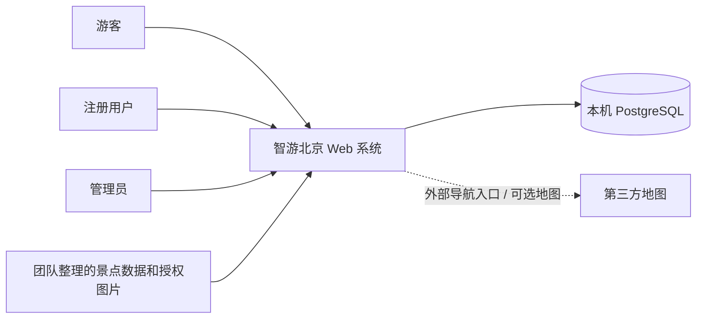
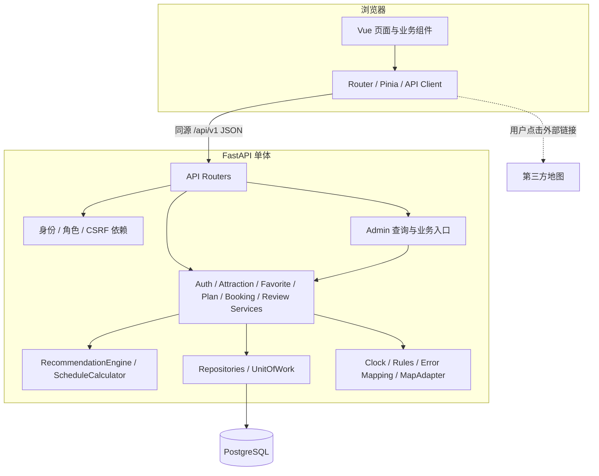
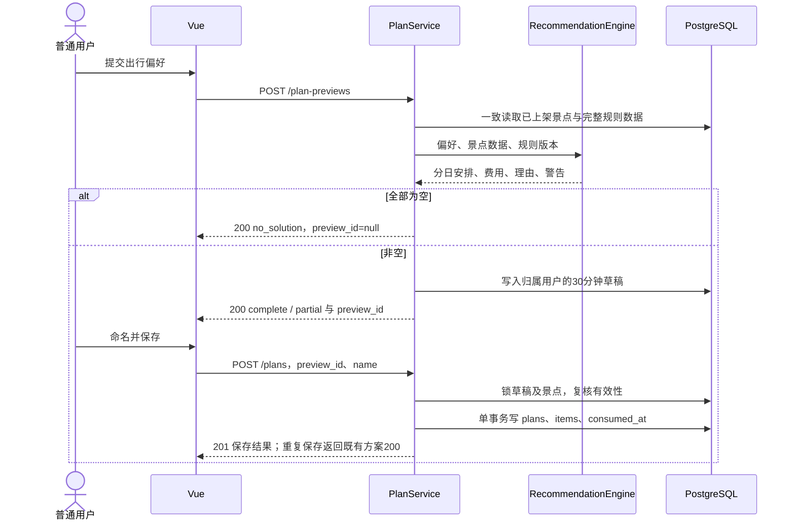
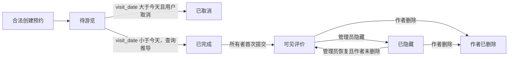
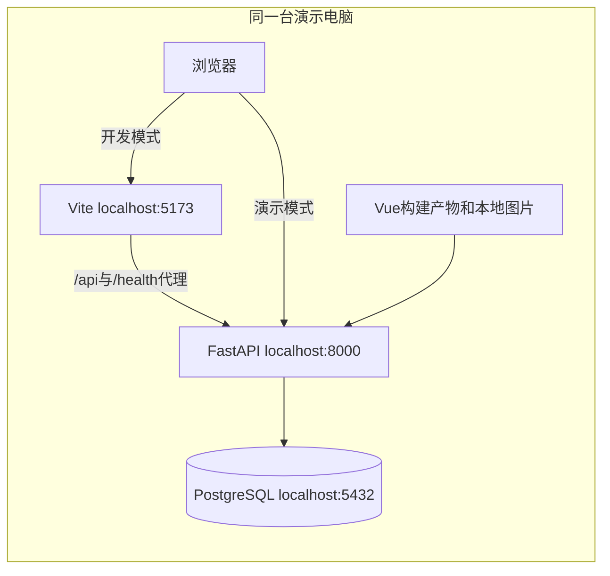

# 智游北京——总体架构设计

> 版本：1.0  
> 日期：2026-10-03  
> 适用范围：高级软件工程课程项目，4 人、暂定 2 周、本机演示  
> 状态：基于现有需求基线的架构设计，尚未实现或完成性能验收  
> 阅读顺序：本文 → [模块设计](./module-design.md) → [数据设计](./data-design.md) → [接口设计](./api-design.md)

## 1. 设计依据与边界

本设计依据 [需求规格说明书](../requirements/requirements.md)、[用户故事](../requirements/user-stories.md)、[验收标准](../requirements/acceptance-criteria.md) 和 [需求决策记录](../requirements/open-questions.md)。项目名称、技术栈、业务规则和优先级以这些需求文件为基线；本文中的 `ADR` 是本次提出的技术设计决策，不代表已经增加或确认了新的产品需求。

课程未指定专用文档模板，因此使用总体架构、接口、数据、模块四个视角，并用 Mermaid 表达组件、部署和关键业务流程。四份文档共同构成设计交付物。

### 1.1 本次覆盖范围

- Must：账号及权限、景点查询及导航入口、收藏、规则推荐、行程保存及同日调整、模拟预约、预约后评价、景点和评价管理、后台预约只读查询。
- Should：景点排序、行程重命名与整份删除、后台统计、嵌入式地图；接口和模块中注明实施优先级。
- Could：复制行程、收藏对推荐的小幅加权；仅预留扩展点，不纳入最低交付承诺。
- 范围外：真实支付和库存、实时天气路况、大模型推荐、跨城市平台、用户账号管理、公网部署。

### 1.2 需求中的表述差异与采用口径

| 位置 | 差异 | 本设计采用口径 | 依据 |
| --- | --- | --- | --- |
| requirements.md §10.2 | 将地图位置和第三方导航入口整体列为 Should | 经纬度及外部导航入口为 Must；嵌入式地图为 Should | FR-POI-008、FR-POI-009、DEC-027 |
| AC-US-002 组合筛选示例 | 使用不在固定分类中的“历史文化” | 示例按“历史古迹”分类及“历史／文化”兴趣标签理解 | requirements.md §8.3、DEC-021 |
| 评价删除后的再次评价 | §8.2“有效评价”措辞可产生不同理解 | 同一预约整个生命周期只能提交一次，作者删除后也不能再提交 | FR-REV-003、DEC-011、AC-US-020 |
| 当日预约的取消 | “待游览”状态可能被误解为必然可取消 | 今天仍是待游览，但只能取消 `visit_date > server_date` 的预约 | FR-BOOK-005、US-018、AC-US-018 |

上述差异仅记录采用依据；本次不改写需求文件。后续团队可在需求阶段同步修正文案。

## 2. 架构目标与约束

| 目标 | 设计策略 | 验证依据 |
| --- | --- | --- |
| 两周内交付可运行闭环 | 一个前端、一个后端进程、一个数据库；按业务模块协作 | 所有 Must 用户故事连续演示 |
| 可解释的推荐 | 硬约束筛选、明确评分、确定性排序、逐项推荐理由 | AC-US-010、AC-US-011 |
| 用户数据隔离 | 服务端角色校验；查询同时包含资源 ID 和所有者 ID | AC-US-006、AC-NFR-003 |
| 历史数据可理解 | 行程项和预约保存景点快照；景点采用下架而非物理删除 | AC-US-022 |
| 写入完整性 | Service 管理事务；唯一约束与行锁保护并发操作 | AC-NFR-004 |
| 可测试、可维护 | 独立规则引擎、可注入时钟、集中规则和配置 | NFR-TEST-001、NFR-MAIN-001 |
| 可测量性能 | 分页、索引、批量加载、无外部网络参与推荐 | 常规查询 p95 ≤ 2 秒；生成 ≤ 5 秒 |
| 外部地图可降级 | 链接生成与核心业务解耦；地址、坐标始终可读 | NFR-REL-002 |

性能数字是验收目标，需要记录环境并实测；图示和算法复杂度不能作为已达标证据。

## 3. 系统上下文

游客可查看已上架景点和公开评价。普通用户拥有个人收藏、行程、预约和评价。管理员使用预置账号进入后台，对预约仅有读取权限，不能代替用户预约、评价或取消预约。管理员不是普通用户权限的自动超集。

第三方地图只承担站外位置及路线展示。景点搜索、推荐计算、预约状态和评价资格均不依赖其返回结果。

## 4. 架构风格与技术方案

### 4.1 架构风格

采用**前后端分离的模块化单体**。前端通过 HTTP JSON API 调用后端；后端按业务模块组织代码，模块在同一进程内调用，共享一个 PostgreSQL 数据库。部署时允许把前端构建产物交由后端提供，前后端代码边界仍然保留。

业务接口使用 `Router → Service → Repository → Database` 分层。推荐及时间重算属于独立的纯计算组件，接收数据对象并返回结果，不直接读取数据库。这样既支持四人并行，又能用单个数据库事务保证预约、评价和行程操作的一致性。

### 4.2 技术选型

| 层次 | 技术 | 用途与选择理由 |
| --- | --- | --- |
| 前端 | Vue 3、TypeScript、Vite | 页面和组件开发、类型约束、本机开发及构建 |
| 路由与状态 | Vue Router、Pinia | 页面路由、登录用户及 CSRF 状态；业务列表按页面加载 |
| 请求层 | 浏览器 Fetch 的统一封装 | Cookie 同源请求、错误转换、超时与分页参数 |
| 后端 | FastAPI、Pydantic 2 | HTTP 路由、请求校验和 OpenAPI 契约 |
| 数据访问 | SQLAlchemy 2、psycopg 3 | 同步 ORM、参数化查询、事务和 PostgreSQL 驱动 |
| 迁移 | Alembic | 表结构、约束和索引的可追溯演进 |
| 数据库 | PostgreSQL | 关系完整性、事务、部分唯一索引、JSONB 快照 |
| 密码 | Argon2id，建议 argon2-cffi | 单向密码哈希，库生成随机盐 |
| 测试 | pytest、FastAPI TestClient、真实 PostgreSQL 测试库；前端 Vitest，关键流程可用 Playwright | 规则、权限、数据库并发及界面流程 |

技术栈中的 Vue、FastAPI、PostgreSQL 来自 DEC-017，其余为设计选型。开始实现时锁定经验证的具体版本，保存 Python 和前端依赖锁定文件；本文不假设“最新版”兼容性已得到验证。

后端采用同步数据库访问，涉及数据库的路由使用普通 `def`，避免在 `async def` 中直接运行阻塞的同步 ORM。FastAPI 对同步处理函数的执行方式见[官方并发说明](https://fastapi.tiangolo.com/async/)。若后续切换异步栈，应同时调整驱动、Session 和事务方式。

### 4.3 容器及组件视图

依赖方向由上至下。Repository 不调用 Service 或 Router；推荐引擎不依赖 ORM；Admin 使用现有业务 Service 修改景点和评价，不复制另一套校验规则。FastAPI 依赖注入用于复用身份和角色校验，依据[官方 Dependencies 文档](https://fastapi.tiangolo.com/tutorial/dependencies/)。

## 5. 模块边界与数据所有权

| 模块 | 主要职责 | 所管理数据 | 跨模块协作 |
| --- | --- | --- | --- |
| Auth | 注册、登录、退出、身份识别 | users、sessions | 提供 Principal，不提供账号封禁或重置密码 |
| Attraction | 景点、固定词表、上架状态、导航信息 | attractions 及开放时间、标签、场次关联 | 向收藏、推荐、预约提供只读景点数据 |
| Favorite | 当前用户收藏及幂等增删 | favorites | 查询景点状态；向统计提供计数 |
| Plan | 生成草稿、保存、调整、重算和警告 | plan_previews、plans、plan_items | 读取景点快照，调用纯推荐和重算组件 |
| Booking | 创建、查询、取消及有效状态 | bookings | 创建时检查景点；向评价提供资格数据 |
| Review | 评价资格、一次性提交、逻辑删除、隐藏恢复、公开评分 | reviews | 读取预约；为景点查询提供公开评分聚合 |
| Admin | 后台授权入口与只读统计查询 | 不另建独立业务数据副本 | 调用 Attraction/Review Service；读取预约及统计 |
| Shared | 时钟、配置、错误、UOW、地图适配 | 不拥有业务实体 | 给业务模块提供基础能力 |

具体文件布局、接口签名和分工见 [module-design.md](./module-design.md)。对跨模块数据的读取由显式查询或查询服务完成，不通过互相调用 Router 或重复 HTTP 请求实现。

## 6. 核心业务流程

### 6.1 登录与权限

1. 注册只创建 `user` 账号；请求中的 `role` 等额外字段被拒绝。管理员由种子初始化脚本从环境变量读取凭据创建。
2. 用户名首尾去空格、英文字母转小写形成唯一规范化值；显示用户名保留原大小写。密码不去空格、不截断。
3. 登录验证成功生成至少 32 字节的随机会话令牌；浏览器保存 HttpOnly Cookie，数据库保存令牌的 SHA-256 摘要。随机令牌摘要与密码哈希承担不同用途。
4. 会话固定有效期设计默认 8 小时；退出删除当前会话并清除 Cookie。其他会话不受当前退出影响。
5. 后端先校验会话及角色，再将 `principal.user_id` 用于资源所有权查询；不接受前端传入所有者 ID。

### 6.2 推荐、草稿与保存

硬约束先于评分：已上架、全程不重复、票价不超剩余总预算、当天开放且完整游玩时段落在每日可用时间内。优先选择至少匹配一个兴趣的可行候选，只有不足时才补充不匹配候选。匹配组内采用默认权重：兴趣 0.40、基础热度 0.25、预算适配 0.20、距离适配 0.15。

推荐先尝试为各日安排一个景点，再逐日补充，使用同一份剩余预算和已选景点集合。采用确定性贪心算法，不承诺全局最优路线。每天至少一项为 `complete`；有景点但存在空日为 `partial`；全部为空为 `no_solution`。未用满时间或预算不自动代表失败，停止安排的原因另外解释。

费用按一人参考门票合计；输入没有住处或出发点，因此每日首个景点的前置交通记为 0，不计往返酒店、跨日交通、餐饮或住宿。相邻景点使用同一 WGS84 坐标系计算直线距离，按 DEC-026 估算交通时间，并明确为参考值。

服务器保存非空草稿的权威内容，客户端保存时只提交草稿 ID 和名称，不能伪造价格或推荐项。未消费草稿保存时，检查所有者、有效期、日期是否仍合法，以及每个景点的上架状态和版本。数据已变化时返回 409 并要求重新生成。已消费且正式方案存在则直接返回原方案；正式方案已删除则返回 `PREVIEW_ALREADY_USED`，不能通过旧草稿复活方案。

### 6.3 已保存行程的调整

- 所有修改先按 `plan_id + user_id` 定位，再锁父方案行并检查 `expected_version`。
- 上移、下移只交换同一天相邻两项；首项上移和末项下移返回业务冲突。
- 删除项后保留其他项相对顺序，并重新连续编号；删除最后一项可以保留空的已保存方案。
- 调整使用已保存的开放时间、游玩时长、坐标和票价快照重算，不读取当前景点信息替换历史内容。
- 时间冲突仍提交成功，返回 `OPENING_TIME_CONFLICT`、`DAILY_TIME_EXCEEDED` 或 `DAY_OVERFLOW`。内部时间用相对游玩日零点的分钟数，允许超过 1439；接口输出带日期的完整时刻，避免把跨日冲突误显示为正常时间。
- 当前景点下架时，读取历史方案可补充 `ATTRACTION_UNAVAILABLE` 诊断；不改变冻结费用、时间或方案版本。

### 6.4 预约与评价

预约持久化 `cancelled_at`，不由定时任务更新完成状态。统一判断顺序：已取消 → `cancelled`；未取消且日期已过 → `completed`；其余 → `pending`。所有查询、筛选、取消和评价资格共用这套逻辑；每次请求只获取一次业务日期，避免跨午夜前后口径不同。

新预约校验上架状态、今天至未来 90 天的闭区间、景点支持场次和 1～10 人；保存景点必要快照并生成唯一预约编号。模拟预约不引入库存、支付或额外营业日限制。

评价只能由对应已完成、未取消预约的所有者提交。`booking_id` 的唯一约束覆盖整个生命周期，作者删除后不能再次评价。管理员隐藏与作者逻辑删除分别记录；管理员不能恢复作者删除的记录。公开平均评分始终只聚合未隐藏、未删除的评价，无评价为 `null` 和计数 0。

## 7. 数据一致性与并发

### 7.1 事务边界

每个业务写操作由一个 Service 创建 UnitOfWork，持有一个 SQLAlchemy Session 并统一提交或回滚。Repository 可以 `flush`，不能自行 `commit`。身份依赖使用独立短读 Session 解析 Principal 后关闭；业务写入再开新的事务，避免身份查询触发自动事务后再错误嵌套 `begin()`。Session 不在多个线程或请求之间共享。事务管理依据 [SQLAlchemy 官方说明](https://docs.sqlalchemy.org/en/20/orm/session_transaction.html)。

| 操作 | 同一事务内必须完成的内容 | 并发保护 |
| --- | --- | --- |
| 新景点或修改 | 主体、完整星期规则、标签、场次、version | 修改先锁景点并检查 expected_version |
| 收藏 | 插入或删除当前用户关联 | UNIQUE(user_id, attraction_id)，冲突转幂等结果 |
| 保存行程 | plans、全部 items、草稿 consumed_at | 锁草稿；source_preview_id 唯一；按 ID 排序锁景点 |
| 调整行程 | 顺序、重新计算的时间和警告、总费用、version | 父方案行锁 + expected_version |
| 创建预约 | 预约主体和快照 | 锁景点；未取消预约的部分唯一索引 |
| 取消预约 | cancelled_at | 锁预约再检查日期和状态 |
| 提交评价 | 评价及资格复核 | 锁预约；booking_id 唯一 |
| 隐藏／删除评价 | hidden_at 或 deleted_at | 锁评价；复核作者删除状态 |

景点读取用于推荐时，先在短的一致性读取事务中加载完整数据，再关闭事务执行计算；不得在推荐循环里逐个查库。保存时重新锁定并检查版本，因此生成与保存之间的景点变更不会静默进入正式方案。

创建预约与管理员修改／下架均锁同一景点行，按实际取得锁的先后确定操作顺序。数据库默认 `READ COMMITTED` 用于常规事务；完整快照多次读取可采用短 `REPEATABLE READ` 只读事务。行锁的行为参考 [PostgreSQL 官方说明](https://www.postgresql.org/docs/current/explicit-locking.html)。

### 7.2 数据库最后防线

- 规范化用户名唯一，收藏组合唯一。
- 未取消预约使用条件 `cancelled_at IS NULL` 的部分唯一索引；索引不依赖不断变化的“今天”。完成但未取消的预约仍属于未取消集合。
- 评价的预约 ID 终身唯一；复合关联约束或事务校验确保评价与预约属于同一用户、同一景点。
- 行程项顺序约束在单事务内交换和重新编号，不能短暂触发不可延迟的顺序唯一检查。
- 外键阻止孤立记录；景点不开放物理删除接口。正式方案整份删除时级联删除其行程项。

部分唯一索引依据 [PostgreSQL 官方文档](https://www.postgresql.org/docs/current/indexes-partial.html)。具体字段、DDL 与迁移方案见 [data-design.md](./data-design.md)。

## 8. 接口与安全

### 8.1 接口统一约定

- 版本前缀 `/api/v1`，JSON 字段使用 `snake_case`，资源 ID 为 UUID 字符串。
- 金额用十进制字符串传输、Decimal 计算；数据库单价及预算 `NUMERIC(10,2)`，预约总额 `NUMERIC(12,2)`。
- UTC 存审计时间，业务日期取 `Asia/Shanghai`；行程预计时刻带日期和 `+08:00`。
- 增长列表 `page=1`、`page_size=20`，最大页容量 100；排序附加稳定 ID，不设置个人记录总数上限。
- 成功直接返回资源或分页对象；错误返回错误码、中文提示、字段问题和 `request_id`。
- 401 表示缺失或失效身份；403 表示角色或 CSRF 不符；404 同时覆盖不存在和他人私有资源；409 表示状态、版本或唯一性冲突；422 表示输入校验失败。

完整请求、响应和端点优先级见 [api-design.md](./api-design.md)。登录和用户查询不输出密码哈希、会话摘要；后台只读预约接口不输出用户凭据。

### 8.2 安全控制

| 风险 | 设计措施 | 验证方式 |
| --- | --- | --- |
| 密码泄露 | Argon2id，随机盐由库生成；日志不记录密码 | 数据库检查、登录成功／失败测试 |
| 会话退出无效 | 服务端会话可撤销；固定到期；退出删除当前会话 | 保存旧 Cookie，退出后直接请求应 401 |
| 跨站请求伪造 | 所有写请求检查配置的 Origin；登录态另校验 X-CSRF-Token；JSON 输入限制 | 缺失或错误 Origin/Token 被拒绝 |
| 越权及对象 ID 伪造 | 后端角色依赖，所有者限定查询，不采信 body.user_id | A 用户访问 B 资源返回 404 且无改动 |
| SQL 注入 | ORM 参数绑定；排序字段映射固定白名单 | 特殊字符作为普通搜索内容处理 |
| 评论脚本执行 | Vue 文本插值；不使用 v-html 渲染评论 | 页面显示文字、不执行脚本 |
| 管理表单覆盖敏感字段 | Pydantic 请求白名单、extra=forbid、角色不能通过注册赋值 | 额外字段及伪造 role 返回 422 |
| 外部链接和素材风险 | 地图由受控域名模板生成；图片优先本地授权资源，记录来源许可 | 检查素材清单与外链域名 |

Cookie 使用 `HttpOnly=true`、`SameSite=Lax`、`Path=/`；本机 HTTP 演示使用 `Secure=false`，与本次部署范围一致。CSRF 令牌由登录响应和 `GET /auth/me` 返回，保存在前端内存；页面刷新后重新读取身份和令牌。注册、登录还没有会话，使用 Origin 与 JSON 校验；已失效会话退出可以幂等清 Cookie。写请求缺失 Origin 也拒绝，直接接口测试需要明确提供允许的 Origin。

会话与 CSRF 方案参考 [OWASP Session Management](https://cheatsheetseries.owasp.org/cheatsheets/Session_Management_Cheat_Sheet.html) 和 [CSRF Prevention](https://cheatsheetseries.owasp.org/cheatsheets/Cross-Site_Request_Forgery_Prevention_Cheat_Sheet.html)。密码方案依据 [OWASP Password Storage](https://cheatsheetseries.owasp.org/cheatsheets/Password_Storage_Cheat_Sheet.html)。

## 9. 本机部署与运行

### 9.1 开发与演示两种布局

开发时浏览器只访问 `http://localhost:5173`，Vite 将 API 和健康检查代理到 8000；演示时只访问 `http://localhost:8000`，FastAPI 同源提供前端构建文件和 API。默认不开启跨域访问，也不混用 `localhost` 与 `127.0.0.1` 产生不同会话域。

静态资源可使用 FastAPI `StaticFiles`，依据[官方说明](https://fastapi.tiangolo.com/tutorial/static-files/)。SPA 路由回退需单独处理：先注册 `/api`、`/health`、`/assets` 等实际路由，再把其他页面路径回退到 `index.html`；不存在的 API 仍返回 JSON 404，不能误回 HTML。

### 9.2 配置及启动步骤

| 配置 | 建议默认／用途 |
| --- | --- |
| DATABASE_URL | 环境变量提供数据库连接，凭据不写入版本库 |
| APP_TIMEZONE | Asia/Shanghai；启动校验，业务时钟统一注入 |
| FRONTEND_ORIGIN | 开发 http://localhost:5173；演示 http://localhost:8000 |
| SESSION_TTL_HOURS | 8，固定有效期 |
| PREVIEW_TTL_MINUTES | 30，未保存草稿有效期 |
| COOKIE_SECURE | 本机 HTTP 为 false |
| PAGE_SIZE_DEFAULT / MAX | 20 / 100 |
| ADMIN_USERNAME / ADMIN_PASSWORD | 种子脚本读取；不在日志及提交文件中明文保存密码 |
| 推荐和字段规则 | 集中到规则配置／常量，见 module-design.md |

上述时长和分页大小是设计默认，可在统一配置中调整。字段长度、金额容量等额外技术边界在接口文档中明确，不能由四位开发者各自定义。

建议启动顺序：安装锁定依赖 → 创建数据库 → 执行 Alembic 迁移 → 导入景点及管理员 → 启动后端 → 开发时启动 Vite，或演示时加载已构建前端 → 检查健康状态 → 按核心故事演示。Docker Compose 可以作为团队已有环境的便利方式，课程验收不依赖 Docker。

### 9.3 种子、备份与诊断

- 景点约 20～30 个，覆盖免费和收费、不同分类兴趣、周闭馆、不同场次及下架历史样例；图片使用团队占位图或有来源和许可的本地素材。
- 评价演示需要历史已完成预约。通过仅用于演示／测试库的初始化脚本构造历史记录，不提供跳过日期校验的公开预约接口。
- 初始化脚本幂等；显式区分空库初始化、补数据和重置操作。已有用户数据不能在普通启动中被清空。
- 演示前使用 `pg_dump` 备份数据库，同时保存图片目录和迁移版本；测试恢复后再作为演示备份使用。
- `/health/live` 检查进程响应，`/health/ready` 检查数据库可连接及迁移版本；失败不返回连接密码等细节。
- 记录 `request_id`、路径模板、状态码、耗时和必要业务错误码；禁止记录密码、Cookie、CSRF 令牌及完整评论正文。
- 清理过期会话和未消费过期草稿可通过本机维护脚本完成；业务规则不依赖清理任务及时运行。保留消费墓碑避免已删除方案被重复保存。

## 10. 地图与其他降级

坐标统一采用 WGS84；采集时需要确认来源坐标系并转换，不能直接混用 GCJ-02、BD-09 或 WGS84。

Must 导航入口由 MapAdapter 根据受控模板生成 Google Maps Directions URL，使用 `api=1`、编码后的 `destination=纬度,经度` 和 `travelmode=transit`；没有起点时在站外使用当前地点或让用户补充。该 URL 方式不需要 API Key，协议见 [Google Maps 官方说明](https://developers.google.com/maps/documentation/urls/get-started)。它不参与站内时间估算，导航是否可用取决于外部服务和演示网络。

可补充高德单点位置入口，使用官方 `marker` URI 的 `coordinate=wgs84`，协议见[高德单点标注文档](https://lbs.amap.com/api/uri-api/guide/mobile-web/point)。单点标注属于位置查看，不能冒充路线导航。若改用高德直接路径规划，需要核验该接口坐标协议并在适配器内完成转换。

| 失败场景 | 处理 |
| --- | --- |
| 没有嵌入地图密钥／地图脚本失败 | 展示地址、坐标、复制入口和外部链接，其他操作继续 |
| 外部导航网站无法访问 | 站内数据保留，提示可复制地址／坐标，仍可生成、保存、预约 |
| 图片加载失败 | 显示本地团队占位图和文本信息 |
| 没有推荐结果 | 返回 no_solution 和中文建议，不保存空草稿 |
| 推荐生成超时 | 返回明确失败码，不留下半份草稿；前端结束加载状态 |
| 数据库写失败 | 回滚整个操作，返回带 request_id 的中文错误 |
| 版本变化／重复提交 | 返回现有结果或 409，前端刷新数据后再操作 |

地图连通性不作为服务器 readiness 的条件。

## 11. 性能与验证计划

### 11.1 性能措施

1. 所有增长列表在数据库执行分页，不加载全量后再截断；固定词表和最多 7 天的完整方案明细不属于分页列表。
2. 公共景点只约 20～30 条，关键词使用参数化包含匹配；当前规模不引入全文搜索服务。
3. 按所有者、日期、景点和排序字段设置索引；评价评分及热门排行先分别聚合收藏／预约，再连接，避免多表连接造成乘法重复计数。
4. 一次加载推荐候选及开放时间；计算时复用距离结果，规模最多 7 天、30 景点，不调用外部地图或模型。
5. 主列表及评分聚合避免 N+1 查询；索引效果用真实 PostgreSQL 测试库检查。
6. 请求超时、数据库连接和查询超时统一设置；不能用前端超时掩盖后端持续写入。写操作超时后重新查询或按幂等规则核验结果。

### 11.2 验证层次

| 层次 | 验证内容 | 验收映射 |
| --- | --- | --- |
| 纯规则单元测试 | 兴趣权重、零预算、闭馆、交通取整、同日重算、跨日警告、日期边界 | AC-US-010、011、013、016、018、020 |
| API 集成测试 | 登录／退出、角色拒绝、他人资源拒绝、字段错误定位、分页 | AC-US-004～007、AC-NFR-003、005 |
| PostgreSQL 事务测试 | 并发重复预约、评价唯一性、草稿重试、版本冲突、失败回滚 | AC-US-012、016、020、AC-NFR-004 |
| 界面端到端 | 游客搜索；用户推荐保存调整预约；管理员下架和隐藏；历史数据仍可读 | 对应 Must 用户故事 |
| 性能和兼容验证 | 记录硬件、软件版本、数据量和并发参数；Chrome/Edge及手机宽度 | AC-NFR-001、002 |

必须使用真实 PostgreSQL 检验部分唯一索引、行锁和可延迟约束，SQLite 替身不能证明这些特性正确。

性能报告建议采用明确的课程样本：25 个景点、50 个普通用户、至少 100 条个人记录及 200 条预约／评价；常规接口预热后各至少 100 次，在 5 个并发访问者下记录 p50/p95、错误率及最大耗时。推荐至少覆盖零预算、单日、多日、闭馆、候选不足等 20 组固定条件，分别检查每次响应是否在 5 秒内。此规模与并发数是建议的测试计划，最终验收报告应写明实际数据。

## 12. 架构决策记录与风险

| ID | 决策及理由 | 代价／替代方案 | 何时重新评估 |
| --- | --- | --- | --- |
| ADR-001 | 模块化单体，符合团队规模和事务需求 | 模块共享数据库，需要保持依赖边界；微服务会增加部署和一致性成本 | 长期多团队独立发布时 |
| ADR-002 | PostgreSQL 服务端 Cookie 会话，便于即时退出 | 多一次会话查询；JWT 若需即时撤销仍需额外状态 | 跨应用授权或真实移动客户端加入时 |
| ADR-003 | 硬约束 + 两阶段贪心规则推荐 | 可解释但不保证全局最优；不采用大模型或精确路线求解 | 用户明确要求路线优化并扩充数据时 |
| ADR-004 | 服务器暂存草稿再保存正式方案 | 多一张辅助表及清理规则，换取不信任客户端行程内容 | 需要长期草稿或协同时 |
| ADR-005 | 历史快照冻结，当前下架独立诊断 | 保存的数据有冗余，需快照版本管理 | 数据量明显增长或需要版本化内容时 |
| ADR-006 | 完成状态按日期派生，不使用定时任务 | 仅表示模拟日期完成，不能证明真实入园 | 接入真实核验系统时 |
| ADR-007 | 平均评分实时聚合，无额外缓存 | 数据量较大时聚合变慢；当前避免缓存失效问题 | 测量显示聚合成为瓶颈时 |
| ADR-008 | 同源本机部署，前后端代码仍分离 | 不验证公网运行要求 | 课程范围扩展为公网部署时 |
| ADR-009 | 写入采用事务、行锁和版本检查 | 需要明确锁顺序及409处理；前端要刷新冲突数据 | 多人协同行程加入时 |

主要风险及控制：

- **集成时间不足**：第一周先打通最小业务链，第二周补边界和验收；Should 按 Must 完成情况推进。详细建议见模块设计。
- **四人各自解释接口**：以 api-design.md 的字段为准；DB 内部字段映射可以不同，禁止在界面与接口中混用。
- **需求措辞差异**：按本文 §1.2 记录的依据实现，团队决定改变行为时先同步需求。
- **模拟与真实信息混淆**：页面标注演示数据、参考票价、模拟预约及非实时交通估算。
- **地图或网络不可达**：外部链接不作为核心业务前置条件，演示前验证网络并准备降级。
- **课程架构设计与实现偏离**：实现时更新对应 ADR、接口和数据文档，保留迁移记录，不仅修改测试。

## 13. 需求到设计的追踪

| 需求／验收范围 | 核心设计 | 详细文档 |
| --- | --- | --- |
| FR-AUTH-001～005；AC-US-004～006 | 规范化用户名、Argon2id、可撤销会话、角色和所有者校验 | API §账号；数据 users/sessions；模块 Auth |
| FR-POI-001～009；AC-US-001～003、008、009 | 上架查询、组合筛选、固定词表、稳定排序、地图适配 | API 景点；数据 attractions；模块 Attraction |
| FR-FAV-001～003；AC-US-007 | 用户限定、组合唯一、幂等操作、下架收藏可撤销 | API 收藏；数据 favorites；模块 Favorite |
| FR-PLAN-001～008、012；AC-US-010～013 | 硬约束、评分、草稿、冻结快照、同日调整及冲突保留 | API 行程；数据 plans/items/previews；模块 Plan |
| FR-PLAN-009～011；AC-US-014、015 | Should 重命名删除，Could 复制／收藏加权扩展 | API 优先级；模块扩展点 |
| FR-BOOK-001～007；AC-US-016～018 | 日期窗口、场次人数、快照、部分唯一、状态派生 | API 预约；数据 bookings；模块 Booking |
| FR-REV-001～008；AC-US-019～021、024 | 完成预约资格、终身唯一、双重逻辑状态、公开评分聚合 | API 评价；数据 reviews；模块 Review |
| FR-ADM-001～008；AC-US-022～025 | 管理员入口、景点版本、预约只读、评价隐藏恢复、统计口径 | API 后台；模块 Admin；数据统计查询 |
| 所有 NFR；AC-NFR-001～005 | 本文安全、事务、降级、性能、测试及部署设计 | 四文档共同覆盖 |

交付验收时，四份设计文档应与实际 OpenAPI、迁移文件、关键测试和演示记录对照。当前交付的是可实施的设计基线，代码、自动化测试、性能结果和运行演示属于后续开发交付。
