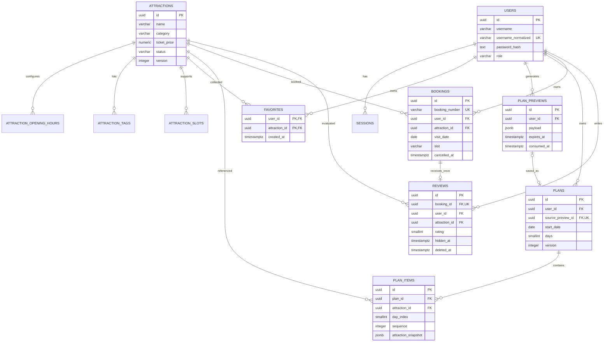

# 智游北京——数据设计

> 文档版本：1.0  
> 编写日期：2026-10-03  
> 文档状态：架构设计基线，数据库、迁移及数据访问代码尚待实现  
> 适用范围：4 人、约 2 周开发周期的本机课程 MVP

## 1. 设计依据与目标

本文依据 [需求规格说明书](../requirements/requirements.md)、[用户故事](../requirements/user-stories.md)、[验收标准](../requirements/acceptance-criteria.md) 和 [未决问题与决策记录](../requirements/open-questions.md)。教师未指定额外模板，采用关系模型、ER 图、字段字典、关键约束、事务及验证场景的课程文档结构。

数据设计服务于景点发现、收藏、规则推荐、行程管理、模拟预约及预约后评价。重点保证个人数据隔离、写操作原子性、重复预约约束、历史快照和评价生命周期；不引入支付、库存、实名信息、账号封禁或跨城市运营模型。系统整体架构见 [architecture.md](./architecture.md)，接口表现见 [api-design.md](./api-design.md)，服务职责见 [module-design.md](./module-design.md)。

## 2. 数据存储与通用约定

### 2.1 存储方案

采用 PostgreSQL 单库、单业务 schema，后端使用同步 SQLAlchemy 2.x ORM、psycopg 3 驱动和 Alembic 迁移。表按领域划分，服务共享一个数据库，但模块不得直接改写其他模块的表。MVP 不使用 Redis、消息队列、搜索引擎或 PostGIS；约 20～30 个景点的经纬度距离由推荐服务计算。

核心关系表保持结构化、可约束的字段；历史景点快照、推荐理由、冲突警告和短期推荐草稿使用 JSONB。快照是有意保留的历史数据，不替代当前景点主数据，也不作为用户可自由上传的任意 JSON。

### 2.2 类型、时间和命名

| 项目 | 约定 |
| --- | --- |
| 主键 | 对外资源使用 `UUID`，由应用生成 UUID v4；关联表使用复合主键，不另造无意义 ID |
| 字段命名 | 数据库和 JSON 使用 `snake_case`，表名使用复数；外键采用 `*_id` |
| 金额 | 单价、预算、方案费用使用 `NUMERIC(10,2)`；预约总额使用 `NUMERIC(12,2)`，容纳最大单价乘 10 人；Python 使用 `Decimal`，API 使用如 `"60.00"` 的十进制字符串 |
| 金额范围 | 单价、预算、方案费用为 0～99,999,999.99；预约总额最多 999,999,999.90；接口拒绝非有限值、负值和超过两位小数的输入，不依赖数据库隐式舍入 |
| 操作时刻 | `TIMESTAMPTZ`，数据库会话时区设 UTC，应用使用带时区的 datetime；API 输出 ISO 8601 |
| 业务日期 | `DATE`，业务“今天”由 `Asia/Shanghai` 时区计算；每个请求固定一个 `today` 和 `now`，供该请求的全部校验共用 |
| 输入时间 | `TIME(0) WITHOUT TIME ZONE`，API 格式 `HH:mm`，范围 00:00～23:59，秒必须为 0；同日开始时间小于结束时间，不支持跨夜输入 |
| 行程估计时间 | 从该游玩日 00:00 起的分钟数，允许超过 1439，避免手工调整后的跨午夜冲突被截断；API 转为带日期与 `+08:00` 的 `scheduled_start` / `scheduled_end` |
| 经纬度 | WGS84，纬度 `NUMERIC(9,6)`、经度 `NUMERIC(10,6)`；范围分别 -90～90、-180～180 |
| 字符长度 | 按 Unicode 字符数校验，不按 UTF-8 字节数；正文作为纯文本存储，页面按文本渲染 |
| 版本 | `attractions.version` 与 `plans.version` 初始为 1，每次有效修改递增；版本用于并发校验及快照来源识别 |

`NUMERIC` 适合精确金额，但超出小数精度的写入可能被舍入，因此前置校验属于接口契约的一部分。[PostgreSQL 数值类型文档](https://www.postgresql.org/docs/18/datatype-numeric.html)。`TIMESTAMPTZ` 表达时刻，`DATE` 表达业务日期，二者不混用。[PostgreSQL 日期与时间类型文档](https://www.postgresql.org/docs/18/datatype-datetime.html)。

表中技术容量、草稿有效期、会话有效期及名称长度为本次设计默认值，不冒充原需求中的已确认 DEC。若需要调整，应同步四份架构文档、校验配置和迁移。

数据库内部字段与 API 不同名时，DTO 映射显式完成，客户端始终使用 [api-design.md](./api-design.md) 中的字段：

| 数据库 / 内部字段 | API 字段 | 转换规则 |
| --- | --- | --- |
| attractions.category | category_code | 编码内容相同 |
| attractions.popularity | base_popularity | 基础热度值相同 |
| bookings.party_size | people_count | 人数值相同 |
| 公开聚合评价数量 | rating_count | 不使用 review_count 别名 |
| plan_previews.payload.input | preferences | 生成条件 DTO，内容相同 |
| plan_items.estimated_start_minute / estimated_end_minute | scheduled_start / scheduled_end | 游玩日期零点加分钟数，输出带日期和 +08:00 |
| attractions.version | attraction_snapshot.attraction_version | 表实体版本到历史快照来源版本 |

### 2.3 固定词表

枚举使用 `VARCHAR + CHECK`，应用集中定义同一组编码与中文展示名称；不创建可编辑词表或词条管理接口。

| 类型 | 编码与展示名称 |
| --- | --- |
| 角色 | `user` 普通用户；`admin` 管理员；游客不建用户记录 |
| 景点分类 | `historical` 历史古迹；`museum` 博物展览；`nature` 自然风光；`landmark` 城市地标；`theme_park` 主题乐园；`arts` 文化艺术 |
| 兴趣标签 | `history` 历史；`architecture` 建筑；`nature` 自然；`culture` 文化；`art` 艺术；`family` 亲子；`photography` 摄影；`leisure` 休闲；`food` 美食 |
| 场次 | `morning` 上午；`afternoon` 下午；`full_day` 全天 |
| 景点状态 | `published` 已上架；`unpublished` 已下架 |
| 预约表现状态 | `pending` 待游览；`completed` 已完成；`cancelled` 已取消；查询推导，不作为数据库持久化枚举 |

## 3. 概念模型与 ER 图

七个核心业务表为 `users`、`attractions`、`favorites`、`plans`、`plan_items`、`bookings`、`reviews`；五个辅助表为 `sessions`、`plan_previews`、`attraction_opening_hours`、`attraction_tags`、`attraction_slots`。



一个用户可拥有多个会话、收藏、草稿、方案、预约和评价。一条草稿最多产生一个正式方案；复制方案若实现，`source_preview_id = NULL`，拥有新的方案及行程项 ID。一条预约全生命周期最多产生一条评价，用户逻辑删除评价后仍保留此关系。

景点修改和下架不删除主记录，不级联删除收藏、行程、预约或评价。正式方案最初非空；用户逐项删除后可以保留空方案，因此 `plans → plan_items` 的下限是 0。未消费草稿不是“我的方案”，生成无结果时不插入草稿。

## 4. 物理模型与字段字典

以下表中的“无”表示无数据库默认值，必须由应用明确赋值；`NULL` 表示允许为空且默认空。未另行注明的资源 ID 由应用提供，无数据库 UUID 默认函数。所有外键 ID 禁止修改；所有 `updated_at` 由成功更新它所属实体的服务在同一事务中赋值，不假设 ORM 自动更新可覆盖所有 SQL 路径。

### 4.1 users：用户

| 字段 | 类型 | 可空 / 默认 | 约束与用途 |
| --- | --- | --- | --- |
| id | UUID | 否 / 无 | PK |
| username | VARCHAR(20) | 否 / 无 | 去除首尾空白后的显示用户名，字符数 3～20；应用校验汉字、ASCII 字母、数字或下划线 |
| username_normalized | VARCHAR(20) | 否 / 无 | UNIQUE；显示用户名中的 ASCII A～Z 转小写，不转换汉字，不做额外兼容字符归一化 |
| password_hash | TEXT | 否 / 无 | Argon2id 完整编码串，含算法参数及盐；不存明文密码 |
| role | VARCHAR(10) | 否 / `'user'` | CHECK IN (`user`,`admin`)；公开注册只能写 `user` |
| created_at | TIMESTAMPTZ | 否 / `now()` | 注册时刻 |

注册前对用户名执行 `strip`，密码不执行 `strip`、不截断，按原字符串 8～64 字符校验后哈希。唯一约束兜底并发注册；重复规范化用户名映射为明确业务冲突。管理员通过独立种子初始化，不接受注册请求中的角色字段。需求排除了账号管理，MVP 不增加状态、封禁、邮箱、手机号等字段。

### 4.2 sessions：服务端会话

| 字段 | 类型 | 可空 / 默认 | 约束与用途 |
| --- | --- | --- | --- |
| id | UUID | 否 / 无 | PK，内部会话记录标识 |
| user_id | UUID | 否 / 无 | FK users.id，ON DELETE RESTRICT |
| token_hash | BYTEA | 否 / 无 | UNIQUE；CHECK `octet_length = 32`；32 字节随机 Cookie token 的 SHA-256 摘要 |
| csrf_token | VARCHAR(64) | 否 / 无 | 另行生成的 32 字节随机值以 base64url 编码，供请求头与服务端会话值比对 |
| created_at | TIMESTAMPTZ | 否 / `now()` | 建立会话时刻 |
| expires_at | TIMESTAMPTZ | 否 / 无 | 建立后固定 8 小时，CHECK expires_at > created_at；不滑动延期 |

每次登录生成新 token，不把 token 明文写入数据库、日志或备份描述。登录 Cookie 的属性及 CSRF 请求规则见接口文档。认证必须同时满足会话存在和 `expires_at > request_now`；过期记录尚未物理清理也不能继续认证。退出删除当前会话，不影响其他会话。可在启动维护命令中删除过期会话，不依赖定时任务维持正确性。

### 4.3 attractions：景点主数据

| 字段 | 类型 | 可空 / 默认 | 约束与用途 |
| --- | --- | --- | --- |
| id | UUID | 否 / 无 | PK |
| name | VARCHAR(100) | 否 / 无 | trim 后 1～100 字符，设计容量 |
| category | VARCHAR(20) | 否 / 无 | 固定六分类 CHECK |
| description | TEXT | 否 / 无 | trim 后 1～5000 字符，设计容量 |
| image_url | TEXT | 否 / 无 | 经校验的受信图片 URL 或本地静态资源路径；不支持上传文件 |
| image_source | TEXT | 否 / 无 | 素材来源页/小组制作说明，strip 后 1～500 字符 |
| image_license | VARCHAR(200) | 否 / 无 | 许可名称及署名要求；占位图记录“小组自制” |
| address | VARCHAR(200) | 否 / 无 | trim 后 1～200 字符 |
| latitude | NUMERIC(9,6) | 否 / 无 | CHECK BETWEEN -90 AND 90 |
| longitude | NUMERIC(10,6) | 否 / 无 | CHECK BETWEEN -180 AND 180 |
| duration_minutes | INTEGER | 否 / 无 | CHECK BETWEEN 1 AND 720，游玩时长设计容量 |
| ticket_price | NUMERIC(10,2) | 否 / 无 | CHECK BETWEEN 0 AND 99999999.99 |
| popularity | SMALLINT | 否 / 0 | CHECK BETWEEN 0 AND 100，预置基础热度，不等于后台热度排行分数 |
| status | VARCHAR(20) | 否 / `'unpublished'` | CHECK IN (`published`,`unpublished`)；创建请求可明确选择合法状态 |
| version | INTEGER | 否 / 1 | CHECK >= 1；主字段或开放时间、标签、场次任一变化均使版本 +1 |
| created_at | TIMESTAMPTZ | 否 / `now()` | 创建时刻 |
| updated_at | TIMESTAMPTZ | 否 / `now()` | 最近修改时刻 |

评分和公开评价数通过 `reviews` 聚合，不落库冗余字段。第三方导航 URL 由位置生成，无须保存多份地图服务链接。位置统一为 WGS84，若接入其他坐标系统由地图适配器转换并明确其含义。

### 4.4 景点开放时间、标签和场次

| 表 / 字段 | 类型 | 可空 / 默认 | 约束与用途 |
| --- | --- | --- | --- |
| attraction_opening_hours.attraction_id | UUID | 否 / 无 | FK attractions.id RESTRICT；与 weekday 构成 PK |
| attraction_opening_hours.weekday | SMALLINT | 否 / 无 | CHECK 1～7，周一为 1，周日为 7 |
| attraction_opening_hours.is_open | BOOLEAN | 否 / 无 | 该星期是否开放 |
| attraction_opening_hours.opens_at | TIME(0) | 是 / NULL | 开放时必填，分钟精度，不跨夜 |
| attraction_opening_hours.closes_at | TIME(0) | 是 / NULL | 开放时必填且晚于 opens_at；关闭时两时间都为 NULL |
| attraction_tags.attraction_id | UUID | 否 / 无 | FK attractions.id RESTRICT；与 tag_code 构成 PK |
| attraction_tags.tag_code | VARCHAR(20) | 否 / 无 | 固定九标签 CHECK；复合主键禁止重复标签 |
| attraction_slots.attraction_id | UUID | 否 / 无 | FK attractions.id RESTRICT；与 slot 构成 PK |
| attraction_slots.slot | VARCHAR(20) | 否 / 无 | 固定三场次 CHECK；复合主键禁止重复场次 |

景点管理服务在一个事务内写主表和关联表，要求恰好 7 条星期记录、至少一个标签和至少一个支持场次。单行 CHECK 和主键不能保证“恰好 7 条”或“至少一条”的跨行规则；该规则由服务校验，种子和验收检查覆盖。周日记录独立于其他日；MVP 无节假日覆写及午休时间段。

### 4.5 favorites：收藏

| 字段 | 类型 | 可空 / 默认 | 约束与用途 |
| --- | --- | --- | --- |
| user_id | UUID | 否 / 无 | FK users.id RESTRICT；与 attraction_id 构成 PK |
| attraction_id | UUID | 否 / 无 | FK attractions.id RESTRICT |
| created_at | TIMESTAMPTZ | 否 / `now()` | 收藏时刻，分页排序依据 |

重复收藏采用 `ON CONFLICT DO NOTHING`；取消收藏物理删除该复合主键记录，可重复调用。新收藏要求景点已上架。已下架景点的已有收藏保留，个人列表标记不可用，仍允许取消收藏；不将它加入新的推荐候选。

### 4.6 plan_previews：待保存的推荐草稿

| 字段 | 类型 | 可空 / 默认 | 约束与用途 |
| --- | --- | --- | --- |
| id | UUID | 否 / 无 | PK，API 的 preview_id |
| user_id | UUID | 否 / 无 | FK users.id RESTRICT，草稿所有者 |
| payload | JSONB | 否 / 无 | CHECK jsonb_typeof = object；服务器生成并校验的非空推荐结果及输入快照 |
| created_at | TIMESTAMPTZ | 否 / `now()` | 生成时刻 |
| expires_at | TIMESTAMPTZ | 否 / 无 | created_at 后 30 分钟，CHECK > created_at |
| consumed_at | TIMESTAMPTZ | 是 / NULL | 首次成功保存时赋值；方案删除后仍保留消费标志，阻止重放复活 |

生成结果先在内存完成，只有非空结果才在短事务内写入草稿。客户端保存时只提交 `preview_id` 与名称，不提交可改写景点、价格或日期的完整方案内容。草稿有效期是数据安全与恢复设计默认值：到期未消费草稿需重新生成；已消费草稿的重试仍可返回尚存的正式方案，不重新生成。

清理只直接删除 `consumed_at IS NULL AND expires_at < now` 的草稿。已消费草稿至少保留至引用方案删除；MVP 演示期建议继续保留消费墓碑。若以后清理已删除方案对应的消费墓碑，原 ID 请求只能返回 404，不得重新创建方案。

### 4.7 plans：个人正式方案

| 字段 | 类型 | 可空 / 默认 | 约束与用途 |
| --- | --- | --- | --- |
| id | UUID | 否 / 无 | PK |
| user_id | UUID | 否 / 无 | FK users.id RESTRICT |
| source_preview_id | UUID | 是 / NULL | UNIQUE；FK plan_previews.id RESTRICT，防同一草稿重复保存；复制方案为空 |
| name | VARCHAR(50) | 否 / 无 | strip 后 1～50 字符，设计默认容量 |
| start_date | DATE | 否 / 无 | 首次生成和保存时不得早于请求 today；历史记录日期可自然变为过去 |
| days | SMALLINT | 否 / 无 | CHECK BETWEEN 1 AND 7 |
| daily_start | TIME(0) | 否 / 无 | 所有游玩日共同开始时间 |
| daily_end | TIME(0) | 否 / 无 | CHECK daily_end > daily_start；分钟精度 |
| budget | NUMERIC(10,2) | 否 / 无 | CHECK BETWEEN 0 AND 99999999.99 |
| tag_codes | TEXT[] | 否 / 无 | 非空、只含固定九标签；服务同时去重；保存本次明确兴趣输入 |
| total_cost | NUMERIC(10,2) | 否 / 0 | CHECK BETWEEN 0 AND 99999999.99；由服务汇总行程项票价，不能由客户端写入 |
| warnings | JSONB | 否 / `'[]'` | CHECK array；方案级警告，含生成不足原因及重算汇总 |
| version | INTEGER | 否 / 1 | CHECK >= 1；调整、重命名时 +1，复制为新方案 version=1 |
| created_at | TIMESTAMPTZ | 否 / `now()` | 创建时刻 |
| updated_at | TIMESTAMPTZ | 否 / `now()` | 最近修改时刻 |

`days` 表示旅行天数，即使某天未安排景点也保留该日。接口的 `day_plans` 根据 start_date、days 和 items 分组构建；日期、每日费用和时长不再重复建日表。正式方案重算使用行程项快照，即使景点后续下架、改价或修改开放时间也不自动改写历史方案。

### 4.8 plan_items：行程项

| 字段 | 类型 | 可空 / 默认 | 约束与用途 |
| --- | --- | --- | --- |
| id | UUID | 否 / 无 | PK |
| plan_id | UUID | 否 / 无 | FK plans.id ON DELETE CASCADE |
| attraction_id | UUID | 否 / 无 | FK attractions.id RESTRICT；UNIQUE(plan_id, attraction_id)，同方案无重复景点 |
| day_index | SMALLINT | 否 / 无 | CHECK BETWEEN 1 AND 7；服务验证 <= plans.days |
| sequence | INTEGER | 否 / 无 | CHECK >= 1；UNIQUE(plan_id,day_index,sequence)，可延迟到提交检查 |
| attraction_snapshot | JSONB | 否 / 无 | CHECK object；完整历史景点与重算依据，结构见第 5 节 |
| estimated_start_minute | INTEGER | 否 / 无 | CHECK >= 0，以对应游玩日 00:00 为原点 |
| estimated_end_minute | INTEGER | 否 / 无 | CHECK > estimated_start_minute；可超过当日，用冲突提示解释 |
| travel_minutes | INTEGER | 否 / 0 | CHECK >= 0；到达本项前的交通估计，首项为 0 |
| cost | NUMERIC(10,2) | 否 / 无 | CHECK BETWEEN 0 AND 99999999.99；等于快照中的参考票价，按一个游客估算 |
| reasons | JSONB | 否 / 无 | CHECK array；非空推荐理由由服务验证，客户端不写入 |
| warnings | JSONB | 否 / `'[]'` | CHECK array；该项的开放时间、时长或跨日冲突 |

同一天顺序保持 1～N 连续。上移/下移使用父方案锁串行化，交换 sequence 前设唯一约束延迟，避免交换中间态与唯一约束冲突。删除行程项后重新连续编号，其他景点保持相对顺序。没有跨天移动接口。

### 4.9 bookings：模拟预约

| 字段 | 类型 | 可空 / 默认 | 约束与用途 |
| --- | --- | --- | --- |
| id | UUID | 否 / 无 | PK |
| booking_number | VARCHAR(35) | 否 / 无 | UNIQUE；`BJ-` + 本预约 UUID 的 32 位无横线大写十六进制串 |
| user_id | UUID | 否 / 无 | FK users.id RESTRICT |
| attraction_id | UUID | 否 / 无 | FK attractions.id RESTRICT |
| visit_date | DATE | 否 / 无 | 创建时 service 校验 today～today+90，包含两个边界 |
| slot | VARCHAR(20) | 否 / 无 | CHECK 固定三场次；创建时校验属于该景点支持场次 |
| party_size | SMALLINT | 否 / 无 | CHECK BETWEEN 1 AND 10 |
| attraction_snapshot | JSONB | 否 / 无 | CHECK object；预约时的名称、地址、参考票价及场次，结构见第 5 节 |
| ticket_price | NUMERIC(10,2) | 否 / 无 | CHECK BETWEEN 0 AND 99999999.99，预约时参考单价；与快照一致 |
| total_amount | NUMERIC(12,2) | 否 / 无 | CHECK total_amount = ticket_price * party_size；模拟参考总额，非支付金额 |
| created_at | TIMESTAMPTZ | 否 / `now()` | 创建时刻 |
| cancelled_at | TIMESTAMPTZ | 是 / NULL | 用户取消时赋值；没有持久化 completed 状态 |

除主键及预约编号外，增加 UNIQUE(id,user_id,attraction_id)，供评价复合外键引用。部分唯一索引限定 `(user_id,attraction_id,visit_date,slot) WHERE cancelled_at IS NULL`，取消后可新建同组合预约。索引判断不含当前日期，已完成且未取消的记录仍满足“未取消”的统一约束。

创建预约不扣库存，不增加票务容量限制，也不额外以景点开放星期拒绝预约；现有需求的预约校验是上架、日期窗口、支持场次、人数、必填字段及重复组合。推荐需要匹配开放时间，这一规则不能误移植为新增的预约产品规则。

### 4.10 reviews：评价

| 字段 | 类型 | 可空 / 默认 | 约束与用途 |
| --- | --- | --- | --- |
| id | UUID | 否 / 无 | PK |
| booking_id | UUID | 否 / 无 | 全表 UNIQUE，逻辑删除后仍占用唯一性 |
| user_id | UUID | 否 / 无 | 与 booking_id、attraction_id 构成复合 FK，引用 bookings(id,user_id,attraction_id) RESTRICT |
| attraction_id | UUID | 否 / 无 | 复合 FK 保障景点及作者与预约完全一致 |
| rating | SMALLINT | 否 / 无 | CHECK BETWEEN 1 AND 5，Pydantic 严格拒绝非整数及布尔值 |
| content | VARCHAR(500) | 否 / 无 | strip 后 5～500 字符，CHECK char_length BETWEEN 5 AND 500 |
| created_at | TIMESTAMPTZ | 否 / `now()` | 首次发表时刻；无编辑评价功能 |
| hidden_at | TIMESTAMPTZ | 是 / NULL | 管理员隐藏时间；恢复时清空 |
| hidden_by | UUID | 是 / NULL | FK users.id RESTRICT；隐藏时必须与 hidden_at 同为非空，恢复时同为空；应用验证其 role=admin |
| deleted_at | TIMESTAMPTZ | 是 / NULL | 作者逻辑删除时间；一旦设置，管理员不能恢复 |

复合外键避免把用户 A 的评价错误关联到用户 B 的预约，或关联错误景点；服务仍必须按当前用户限定预约查询并校验资格。`hidden_at` 和 `deleted_at` 是两个独立事实；用户删除已隐藏评价不清除原隐藏记录。公开条件固定为 `hidden_at IS NULL AND deleted_at IS NULL`。

## 5. JSONB 快照及派生数据契约

### 5.1 快照结构

所有快照包含 `schema_version`，由 Pydantic 专用模型校验后写入；未知/损坏结构报明确数据错误，不用最新景点静默补全。行程项使用 API 的完整 `AttractionSnapshot`，预约使用独立轻量 `BookingSnapshot`，不能互相混用。attraction_id 保存在外层 item/booking，不在快照重复。以下展示一个行程项景点快照：

```json
{
  "schema_version": 1,
  "attraction_version": 3,
  "name": "示例历史景点",
  "category_code": "historical",
  "description": "用于展示历史快照结构的示例景点。",
  "image_url": "/assets/placeholders/attraction.svg",
  "image_source": "小组自制示例占位图",
  "image_license": "小组自制",
  "address": "北京市示例地址",
  "latitude": 39.9163,
  "longitude": 116.3972,
  "coordinate_system": "WGS84",
  "ticket_price": "60.00",
  "duration_minutes": 120,
  "tag_codes": ["history", "architecture"],
  "base_popularity": 85,
  "booking_slots": ["morning", "afternoon"],
  "opening_hours": [
    {"weekday": 1, "is_open": false, "opens_at": null, "closes_at": null},
    {"weekday": 2, "is_open": true, "opens_at": "08:30", "closes_at": "17:00"},
    {"weekday": 3, "is_open": true, "opens_at": "08:30", "closes_at": "17:00"},
    {"weekday": 4, "is_open": true, "opens_at": "08:30", "closes_at": "17:00"},
    {"weekday": 5, "is_open": true, "opens_at": "08:30", "closes_at": "17:00"},
    {"weekday": 6, "is_open": true, "opens_at": "08:30", "closes_at": "17:00"},
    {"weekday": 7, "is_open": true, "opens_at": "08:30", "closes_at": "17:00"}
  ]
}
```

名称、地址、位置、票价、游玩时长、每周开放时间及标签用于显示历史内容并重算时间、距离和费用；description、图片来源许可、基础热度及支持场次保持与完整接口快照一致。外层 attraction_id 和快照 attraction_version 是溯源字段；下架不改变已经保存的快照。示例仅说明结构，不作为实际景点信息承诺。图片加载失败使用通用占位图，不把第三方图片可用性作为快照可靠性前提；不静默替换快照中的来源信息。

预约快照为独立的轻量结构：

```json
{
  "schema_version": 1,
  "attraction_version": 3,
  "name": "示例历史景点",
  "address": "北京市示例地址",
  "ticket_price": "60.00",
  "slot": "morning"
}
```

人数、游览日期和总额由预约结构化字段保存，不重复加入快照。服务一次从已锁定景点构造 ticket_price 和快照，避免二者来源不一致。

### 5.2 草稿 payload

草稿 `payload` 至少包含以下字段，其内容只由推荐服务生成：

| 字段 | 结构 | 用途 |
| --- | --- | --- |
| schema_version | 整数 1 | 结构版本 |
| input | start_date、days、daily_start、daily_end、budget、tag_codes | 固定生成输入，保存时再次检查日期 |
| total_cost | 金额字符串 | 生成方案总费用 |
| day_plans | day_index、date、items、warnings | 分日结果，包含完整/部分日；整个结果必须至少含一个 item |
| items | id（草稿项 UUID）、attraction_id、sequence、attraction_snapshot、estimated_start_minute、estimated_end_minute、travel_minutes、cost、reasons、warnings | 正式行程项的可信来源；每个快照保存 attraction_version |
| warnings | 警告数组 | 候选不足、预算/时间受限等可理解原因 |

正式保存复制可信 payload 的输入与 items，生成新的 plan/item ID，不复用草稿中客户端展示序号作为数据库主键；同时将警告引用中的草稿 item_id 重映射为新建行程项 ID。payload 内部 `input` 和分钟数字段由序列化器映射为 API `preferences` 与 `scheduled_start/scheduled_end`，不是另一个对外接口契约。payload 不接受客户端覆盖。当前上架状态和版本检查只用于“首次保存”；个人已保存方案查询、调整、取消历史预约及评价资格不依赖景点当前上架状态。

### 5.3 警告与时间计算

警告数组元素固定为 `{ "code": "...", "message": "中文说明", "day_index": 1, "item_id": null }`；涉及具体行程项时 item_id 非空，方案级 day_index 可为空。持久化重算警告包括 `OPENING_TIME_CONFLICT`、`DAILY_TIME_EXCEEDED`、`DAY_OVERFLOW`；生成不足原因使用 `NO_PUBLISHED_ATTRACTIONS`、`BUDGET_LIMIT`、`TIME_LIMIT`、`CANDIDATES_EXHAUSTED`。代码的具体接口枚举以 API 文档为准，message 只表达原因，不携带 SQL 或内部异常。

读取历史方案时可以批量读取当前景点 status，附加 `current_available` 及 `ATTRACTION_UNAVAILABLE` 诊断；该诊断是即时响应信息，不覆写已保存 warnings、快照、时间、票价或 plan.version，也不阻止用户继续调整、取消历史预约或按资格评价。

费用为全部 item.cost 之和；重算后 plan.total_cost、每个行程项时间和 warnings 在同一个事务提交。交通估计为直线距离 ÷ 20 km/h + 15 分钟并向上取整至 5 分钟，首项 0 分钟，等候开放产生的等待时间计入日占用时长。每日 `total_duration_minutes` 是该日最晚预计结束减 daily_start，包括交通与等待；空日为 0。跨午夜结果不裁剪，标记 `DAY_OVERFLOW`，并由日期加分钟得到完整时间输出。

### 5.4 不持久化的派生值

| 派生值 | 统一计算口径 |
| --- | --- |
| 预约状态 | cancelled_at 非空 → cancelled；否则 visit_date < request_today → completed；否则 pending |
| 能否取消 | 当前用户所有者、cancelled_at 为空、visit_date > request_today；当天不能取消 |
| 能否评价 | 当前用户所有者、cancelled_at 为空、visit_date < request_today、全表无对应 booking_id 的评价 |
| 公开评分 | 只聚合 hidden_at 和 deleted_at 都为空的评价；API 均分保留两位小数；无评价时 rating=null、rating_count=0 |
| 后台数量 | users 只统计 role=user；attractions 含上下架；bookings 含所有状态；plans 只统计现存正式方案，不包含草稿 |
| 后台热门分数 | 收藏数 + 2 × 未取消预约数；同分按基础 popularity 降序，再按 id 稳定排序 |
| 兴趣分布 | 对正式 plans.tag_codes 的选择次数聚合，一个方案对同一标签最多计一次；统计含全部九词条及零值 |

公开评分在查询时通过一次分组 SQL 聚合，并与景点列表 JOIN，避免逐景点查询造成 N+1 问题。隐藏、恢复、删除提交后，下一查询即可反映新值，MVP 不设评分缓存，因此没有缓存刷新和评分漂移问题。

一次后台统计请求在同一个短只读一致快照中完成全部数量、排行及兴趣分布聚合，避免多条 SQL 之间写入变化造成口径矛盾。热门排行先分别聚合收藏与预约，再连接景点，不直接连接两张明细表后计数，防止收藏数与预约数相乘造成重复。

## 6. 关键约束与 DDL 示意

下面 SQL 展示需要在 Alembic 中显式落地的关键规则，不是已经执行的完整建表脚本。完整字段应按第 4 节建表，并为约束赋稳定名称，便于映射业务错误及迁移。数据库 CHECK 只处理本行静态事实；跨行规则使用 UNIQUE/FK，日期随时间变化及跨表业务状态由服务处理。[PostgreSQL 约束文档](https://www.postgresql.org/docs/18/ddl-constraints.html)。

```sql
-- 并发注册、收藏与行程唯一性
ALTER TABLE users ADD CONSTRAINT uq_users_username_normalized
  UNIQUE (username_normalized);
ALTER TABLE favorites ADD CONSTRAINT pk_favorites
  PRIMARY KEY (user_id, attraction_id);
ALTER TABLE plans ADD CONSTRAINT uq_plans_source_preview
  UNIQUE (source_preview_id);
ALTER TABLE plan_items ADD CONSTRAINT uq_plan_item_attraction
  UNIQUE (plan_id, attraction_id);
ALTER TABLE plan_items ADD CONSTRAINT uq_plan_item_sequence
  UNIQUE (plan_id, day_index, sequence) DEFERRABLE INITIALLY IMMEDIATE;

-- 主键/FK/NOT NULL 须按字典预先建立
ALTER TABLE bookings ADD CONSTRAINT uq_booking_reference
  UNIQUE (id, user_id, attraction_id);
ALTER TABLE reviews ADD CONSTRAINT uq_review_booking
  UNIQUE (booking_id);
ALTER TABLE reviews ADD CONSTRAINT fk_review_booking_identity
  FOREIGN KEY (booking_id, user_id, attraction_id)
  REFERENCES bookings (id, user_id, attraction_id) ON DELETE RESTRICT;

-- 只限制尚未取消的预约；允许取消后重新预约
CREATE UNIQUE INDEX uq_booking_not_cancelled
  ON bookings (user_id, attraction_id, visit_date, slot)
  WHERE cancelled_at IS NULL;

ALTER TABLE attraction_opening_hours ADD CONSTRAINT ck_opening_range
  CHECK (
    (NOT is_open AND opens_at IS NULL AND closes_at IS NULL)
    OR
    (is_open AND opens_at IS NOT NULL AND closes_at IS NOT NULL
     AND opens_at < closes_at
     AND opens_at >= TIME '00:00' AND closes_at < TIME '24:00'
     AND EXTRACT(SECOND FROM opens_at) = 0
     AND EXTRACT(SECOND FROM closes_at) = 0)
  );
ALTER TABLE plans ADD CONSTRAINT ck_plan_daily_time
  CHECK (daily_start < daily_end AND daily_start >= TIME '00:00'
    AND daily_end < TIME '24:00'
    AND EXTRACT(SECOND FROM daily_start) = 0
    AND EXTRACT(SECOND FROM daily_end) = 0);
ALTER TABLE plans ADD CONSTRAINT ck_plan_tags
  CHECK (cardinality(tag_codes) >= 1
    AND array_position(tag_codes, NULL) IS NULL
    AND tag_codes <@ ARRAY['history','architecture','nature','culture','art',
      'family','photography','leisure','food']::text[]);
ALTER TABLE bookings ADD CONSTRAINT ck_booking_amount
  CHECK (total_amount = ticket_price * party_size);
ALTER TABLE reviews ADD CONSTRAINT ck_review_hidden_pair
  CHECK ((hidden_at IS NULL) = (hidden_by IS NULL));
ALTER TABLE sessions ADD CONSTRAINT ck_session_hash
  CHECK (octet_length(token_hash) = 32);
```

部分唯一索引只对满足谓词的行执行唯一检查，适合“未取消预约”而非全部预约的唯一性。[PostgreSQL 部分索引文档](https://www.postgresql.org/docs/18/indexes-partial.html)。不要把 `CURRENT_DATE`、`now()`、景点当前状态、预约是否完成或评价是否隐藏写进动态 CHECK/部分唯一谓词；否则不能保证随时间流逝持续成立，也会使业务含义与历史数据冲突。

## 7. 索引与查询设计

| 索引 | 类型 / 列 | 主要查询 |
| --- | --- | --- |
| uq_users_username_normalized | 唯一 B-tree | 登录用户名定位、并发注册判重 |
| uq_sessions_token_hash | 唯一 B-tree | Cookie 摘要定位会话 |
| ix_sessions_expires | B-tree(expires_at) | 清理过期会话 |
| ix_favorites_user_created | B-tree(user_id,created_at DESC,attraction_id) | 当前用户收藏分页 |
| ix_favorites_attraction | B-tree(attraction_id) | 后台收藏数聚合 |
| ix_attractions_status_category | B-tree(status,category) | 上架景点及分类筛选 |
| ix_attraction_tags_code | B-tree(tag_code,attraction_id) | 标签筛选；多标签按 API 约定全匹配 |
| ix_previews_unused_expires | B-tree(expires_at) WHERE consumed_at IS NULL | 未消费过期草稿清理 |
| ix_plans_user_created | B-tree(user_id,created_at DESC,id ASC) | 我的方案分页 |
| uq_plan_item_sequence | 唯一 B-tree(plan_id,day_index,sequence) | 按天顺序读取；支持延迟检查 |
| uq_booking_not_cancelled | 部分唯一 B-tree | 防重复预约 |
| ix_bookings_user_created | B-tree(user_id,created_at DESC,id ASC) | 我的预约分页 |
| ix_bookings_visit_attraction | B-tree(visit_date,attraction_id,id) | 管理预约日期、景点筛选 |
| ix_bookings_attraction_active | B-tree(attraction_id) WHERE cancelled_at IS NULL | 后台未取消预约计数 |
| uq_review_booking | 唯一 B-tree | 一次评价与资格查询 |
| ix_reviews_public_attraction | B-tree(attraction_id,created_at DESC,id ASC) WHERE hidden_at IS NULL AND deleted_at IS NULL | 公开评价分页与评分聚合 |
| ix_reviews_user_created | B-tree(user_id,created_at DESC,id ASC) | 我的评价分页 |
| ix_reviews_admin_created | B-tree(created_at DESC,id ASC) | 全量评价管理分页 |

主键/唯一约束自动提供的索引不重复创建。每个外键是否单独建立索引按上述查询需求决定，不认为 FK 自动生成子表索引。搜索使用绑定参数的 `ILIKE` 查询名称和简介，搜索用户输入中的 `%`、`_` 和转义符作为普通字符；20～30 个景点无需专门全文索引。推荐一次读取候选景点、开放时间和标签后在内存计算，避免候选循环内反复查库。

列表采用页码分页，统一 `page>=1`、`page_size=1..100`、默认 20；增长列表不设个人总量上限。所有分页有稳定次级排序（通常 created_at DESC,id ASC，收藏用 attraction_id ASC）；按价格、热度或评分排序时追加 id ASC。评分为 NULL 的景点置于有评分之后。分页 total 与 items 可用同一读事务快照获取，普通统计允许相邻请求间发生正常更新。

## 8. 事务、隔离与并发控制

### 8.1 事务管理

MVP 使用 PostgreSQL 默认 `READ COMMITTED` 隔离级别，结合行锁和唯一约束控制关键并发。认证依赖通过独立短读 Session 解析 Principal 后关闭；业务服务再通过 uow_factory 创建新的 Session，并在 UnitOfWork 中显式 `session.begin()`，成功统一提交、异常统一回滚。此方式避免身份查询触发 autobegin 后再嵌套 begin 的实现问题。Repository 只查询/flush，不自行 commit；Session 不跨请求或线程共享。[SQLAlchemy 事务与连接管理文档](https://docs.sqlalchemy.org/en/20/orm/session_transaction.html)。

推荐候选的景点主表、七日开放时间、标签和场次在短 `REPEATABLE READ` 只读事务内批量读完，得到一致的完整 DTO，关闭读事务后进行纯规则计算；后续草稿写入使用独立短事务。保存草稿时仍按景点行锁复核版本，不能以生成时的一致快照取代保存时的有效性检查。

`SELECT ... FOR UPDATE` 用于需要串行决策的景点、草稿、方案及预约记录；锁持有至事务结束，事务内不调用地图、文件下载等外部服务。[PostgreSQL 显式锁文档](https://www.postgresql.org/docs/18/explicit-locking.html)。多个景点按 UUID 升序加锁，所有服务遵循同一顺序；事务保持短小。

### 8.2 关键写操作

| 场景 | 事务内步骤与并发兜底 |
| --- | --- |
| 注册 | 规范化用户名与哈希后插入 user；唯一冲突回滚并返回用户名已占用，不靠“先查后插”保证唯一 |
| 登录 / 退出 | 登录凭据通过后插入会话；退出按 token_hash 删除当前会话；失败不留下有效会话 |
| 景点新增 / 修改 / 下架 | 管理员角色校验；修改锁 attraction 并验证 expected_version；整体校验字段、7 日开放、标签、场次；主表与关联表同事务更新并 version+1 |
| 保存推荐草稿 | 先按 user_id+preview_id 锁草稿；已消费时找其正式方案，尚存则返回同一方案，已删则 409 PREVIEW_ALREADY_USED；未消费再校验未过期、开始日期合法；按 ID 顺序锁全部涉及景点，要求 published 且 version 与快照一致，否则 409 要求重新生成；创建 plan/items 并设置 consumed_at 后一次提交 |
| 调整 / 删除行程项 | 按 user_id+plan_id 锁父 plan，验证 expected_version；找同一天 item，验证非首/末边界；延迟 sequence 唯一检查，交换或删后重新编号；从已保存快照重算，持久化冲突，不回滚用户合法操作；更新合计和版本后提交 |
| 重命名 / 删除方案 | 重命名按所有者锁 plan 并验证 expected_version；整份删除先锁 source 草稿（若有）再锁 plan，并验证 expected_version；删除 plan 级联 items；保留 source 草稿 consumed_at，因此重复保存原草稿不会复活已删方案 |
| 创建预约 | 锁 attraction，要求已上架并读取支持场次；验证请求固定 today 日期窗口、人数；构造快照和金额，插入预约；部分唯一冲突返回重复预约并回滚 |
| 取消预约 | 按 user_id+booking_id 锁 booking；已取消返回 409 BOOKING_ALREADY_CANCELLED 且无二次变化；未取消要求 visit_date > today，更新 cancelled_at；当天/完成拒绝；不受景点下架影响 |
| 创建评价 | 按当前用户限定并锁 booking，验证未取消、visit_date < today；全生命周期 UNIQUE booking_id 兜底重复评价；写入 author/attraction 从 booking 推导，不能接受客户端伪造 |
| 作者删除 / 管理员隐藏恢复 | 按权限锁 review；作者删除仅设置 deleted_at；管理员恢复要求 deleted_at IS NULL，隐藏/恢复更新 hidden_at+hidden_by，不改作者、正文或评分 |

保存草稿时行锁与景点管理/预约创建使用同一景点锁，保证“读取可用版本并落快照”与管理员修改串行化；允许生成阶段得到随后过期的草稿，但首次保存会拒绝陈旧版本，不会默默保存已下架景点。同一草稿双击保存仅创建一个方案。

删除方案与重试保存的锁顺序约定为“先 source 草稿、后 plan”；没有 source 的复制方案只锁 plan，避免两个路径互相反向等待。失去客户端响应后重试保存不消耗新的草稿，不生成第二份方案。锁冲突与数据库错误回滚后映射为接口约定的 409/服务错误，不向用户泄露底层错误内容。

### 8.3 数据库规则与服务规则的边界

| 数据库保证 | 服务层保证 |
| --- | --- |
| PK、FK、非空、范围、固定枚举、复合唯一、未取消预约唯一、一次评价 | 登录角色与资源所有权；管理员只读预约；用户名字符及归一化；恰好 7 日配置；至少一个标签/场次 |
| 单行时间顺序和金额乘人数一致 | today 日期窗口；未到访可取消；完成才可评价；当前景点上架及支持场次；首/末项移动规则 |
| JSONB 对象/数组基本形状 | 快照详细 schema、票价与快照一致、草稿所有者、版本复核、方案费用汇总、推荐约束、同日顺序连续、跨午夜冲突提示 |

资源 UUID 不是权限凭据。个人资源查询必须从 `WHERE user_id = current_user.id` 起步；不存在和属于他人的资源统一按接口约定返回 404，避免暴露资源存在性。数据库约束作为最终完整性保护，不替代服务授权。

## 9. 删除、保留与数据安全

| 数据 | 删除 / 保留策略 |
| --- | --- |
| 用户 | MVP 无账号删除或封禁接口；其他实体 FK RESTRICT，禁止误删作者和历史归属 |
| 景点 | 仅修改 status 下架，保留主记录、来源许可及版本；无物理删除接口 |
| 收藏 | 用户取消时物理删除；下架不自动删除已有收藏 |
| 正式方案及项 | 用户整份删除时硬删 plan，items CASCADE；单项删除硬删 item；不删除对应消费墓碑 |
| 草稿 | 未消费过期可清理；已消费至少保留到方案删除，本期保留墓碑；不是正式个人方案数量指标 |
| 预约 | 取消只写 cancelled_at；保留预约快照及编号，不提供物理删除或管理员修改 |
| 评价 | 用户删除写 deleted_at，管理员隐藏写 hidden_at；均不物理删除，保留一次评价约束和操作事实 |
| 会话 | 退出即时删除；过期可维护清理；token 明文不持久化 |

密码哈希、会话摘要和 CSRF token 不进入普通用户/管理员列表响应；日志只记录 request_id、操作类型、资源 ID、结果和必要异常类别，不记录密码、Cookie、完整评论或完整草稿。ORM 使用绑定参数，排序字段由固定允许集合映射，避免字符串拼接 SQL。数据库连接与种子管理员初始密码通过本地环境配置，禁止提交进仓库；示例环境文件仅包含占位值。

## 10. 初始化、迁移和备份

### 10.1 种子数据

1. 预置约 20～30 个北京示范景点，覆盖六分类、九标签、不同票价/时长/热度，包含免费、每周关闭日和三类场次的代表组合；每个景点恰好 7 条开放时间记录。
2. 每条图片记录开放许可来源或“小组自制”说明，不能把来源不明网络图片写入种子。
3. 种子使用稳定 UUID，按 ID 幂等插入/维护，重复执行不重复创建景点。更新已有景点时遵循关联表整体写入及 version 递增，不覆写已保存快照。
4. 管理员初始化显式读取环境变量生成 Argon2id 哈希；缺失凭据时停止并提示，不内置通用明文密码。普通演示账号仅在独立演示数据模式生成。
5. 历史完成预约与评价演示使用显式 demo fixture，按固定测试时钟或相对业务日期创建，不能开放“绕过日期校验”的生产 API。测试数据与正式种子分离。
6. 在页面及文档中标注演示数据、参考价格和模拟预约，不承诺实时官方数据。

### 10.2 Alembic 迁移

首个迁移创建所有表、外键、CHECK、部分索引与可延迟顺序唯一约束；种子导入独立于迁移，避免每次结构升级自动覆盖业务数据。ORM 模型、迁移和此字典同时维护，约束命名固定。自动生成迁移必须人工核对，尤其关注部分索引、JSONB 默认值、复合外键和 DEFERRABLE 属性。

开发流程为“变更设计 → 生成/审查迁移 → 在空库升到 head → 导入种子 → 在已有数据库升级 → 运行约束及业务验证”。禁止靠手改数据库替代版本迁移。删除列、缩短字段或改枚举先做备份及数据检查；课程阶段若选择重建库，需明确其仅针对可丢弃的开发数据。

### 10.3 备份与恢复

本机 MVP 每次重要演示前和破坏性迁移前使用 `pg_dump` custom 格式创建备份，记录数据库版本、迁移 revision、种子版本和备份时间；使用 `pg_restore` 在独立测试数据库恢复并检查核心数量、快照可读性与唯一约束。备份应与源库分开保存，避免将含密码摘要/个人评论的备份提交至仓库。[PostgreSQL SQL Dump 文档](https://www.postgresql.org/docs/18/backup-dump.html)。

恢复到演示环境后清空 sessions，要求重新登录；保留业务数据和预约评价历史。MVP 不承诺商业级 RPO/RTO；建议团队进行一次恢复验证并记录耗时，作为工程验证记录，不增加 MVP 必须演示备份恢复的验收要求。上述策略为待实现方案，不代表已经完成数据库备份验证。

## 11. 需求追踪与验证场景

| 需求 / 验收 | 数据设计落点 | 待实现验证 |
| --- | --- | --- |
| FR-AUTH-001～005；AC-US-004～006 | users 归一化唯一、Argon2id、sessions；服务所有者条件 | 空格/大小写等价用户名并发注册只成功一次；退出和过期后拒绝受保护请求；不存明文密码 |
| FR-POI-001～008；FR-ADM-002～004；AC-US-001～003、022 | attractions、七日开放、标签/场次关联、来源许可、版本 | 非法分类/票价/经纬度/时间拒绝；组合筛选；下架不进入新候选而历史仍可读 |
| FR-FAV-001～003；AC-US-007 | favorites 复合主键、所有者分页 | 重复提交不产生第二条；用户 B 无法读取或删除用户 A 收藏；下架收藏可取消 |
| FR-PLAN-001～008、012；AC-US-010～013 | previews、plans、items、快照、顺序唯一及版本 | 无结果无草稿；草稿双击保存只建一个方案；过期/日期过时/景点版本变化拒绝首次保存；改序重算并保留冲突 |
| FR-PLAN-009～010；AC-US-014～015 | plan 硬删、消费墓碑；复制 source_preview_id=NULL | 删除方案级联项而不复活；复制新 ID、修改不影响原方案（Could） |
| FR-BOOK-001～007；AC-US-016～018 | 日期/场次/人数校验、部分唯一、快照、cancelled_at | today 与 today+90 通过，today-1/today+91 拒绝；并发重复预约只一条；取消后可重新预约；当天不能取消 |
| FR-REV-001～008；AC-US-019～021、024 | review booking 全生命周期唯一、复合 FK、双删除状态 | 未完成/已取消无资格；删除后不能再次评价；隐藏/删除均不计入评分；管理员不能恢复作者删除记录 |
| FR-ADM-005～008；AC-US-023～025 | 只读预约、评分/热度/兴趣聚合 | 普通用户调用后台拒绝；状态过滤正确；排行按独立 SQL 对照，取消排除；统计不把草稿计作方案 |
| NFR-PERF-001～003、NFR-REL-001；AC-NFR-001、004、005 | 稳定分页、索引、事务短写、候选批量读 | 失败注入后无半完成 plan/booking；超过单页仍可访问全部个人记录；记录环境下达成性能目标 |
| NFR-SEC-001～004、NFR-DATA-001～002；AC-NFR-003 | 绑定参数、最小响应字段、摘要、来源许可 | 注入样本仅作为数据；密码/Cookie 不进入日志；资源越权拒绝；检查所有图片来源 |

还需专门覆盖四个数据库边界：最大票价 × 10 人不溢出；午夜前后同一请求的 today 不变化；延期唯一检查支持顺序交换且提交时拒绝重复 sequence；手工重算到次日时保留分钟数和 DAY_OVERFLOW。关键 SQL/并发验证应在 PostgreSQL 测试库运行，不以 SQLite 的行为替代部分索引、锁和复合外键的验收。

## 12. 设计完成与实现交接

本文交付的是可实现的数据方案。下一阶段按七个核心表和辅助表建立模型与迁移，再实现事务、权限、快照及派生查询，最后执行第 11 节场景。实现若需要更改快照字段、金额容量、状态定义或唯一性规则，应同步 API 和模块设计，并在必要时走需求变更记录，避免各成员独立选择不同数据口径。
