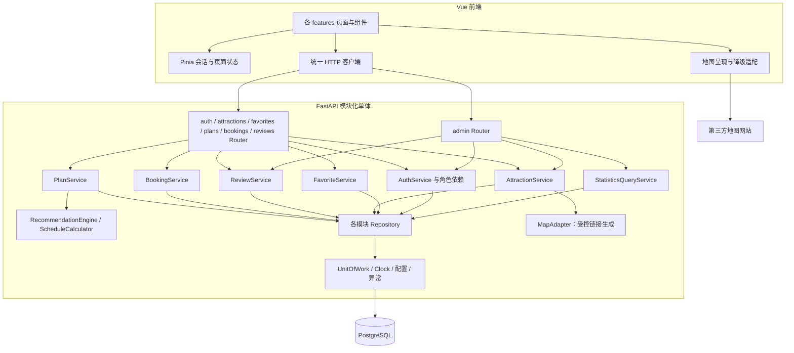
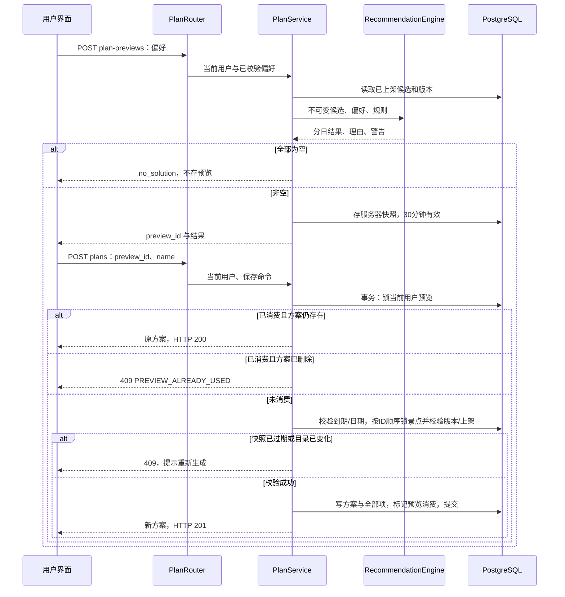
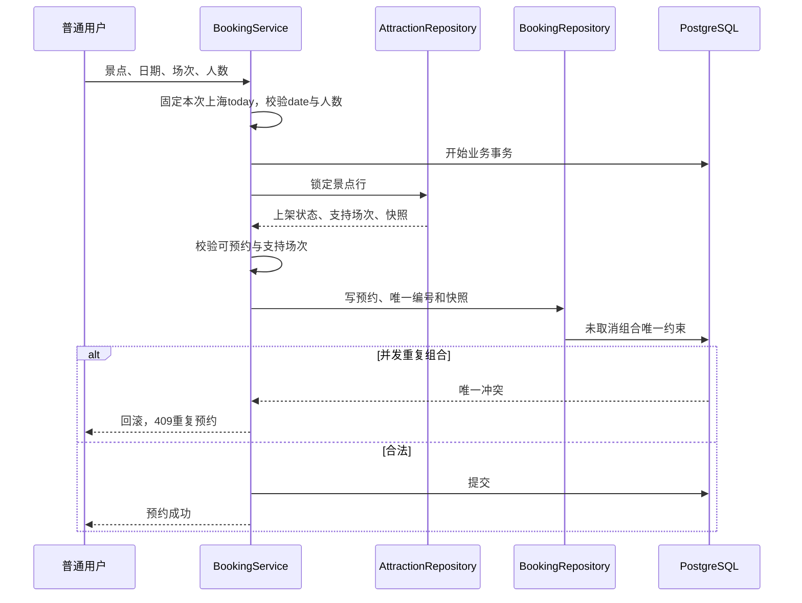
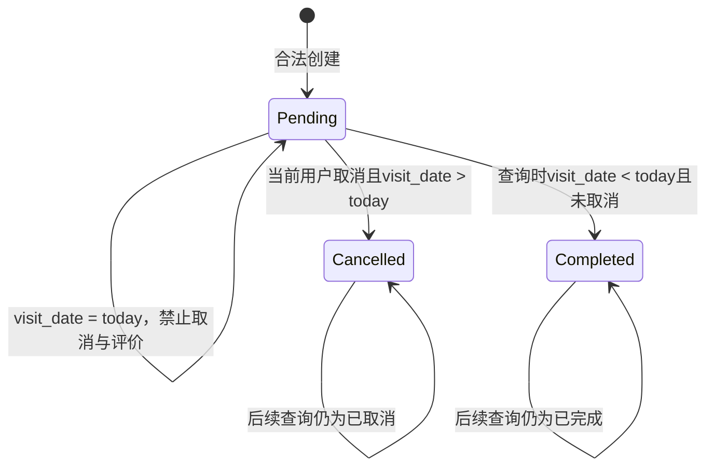
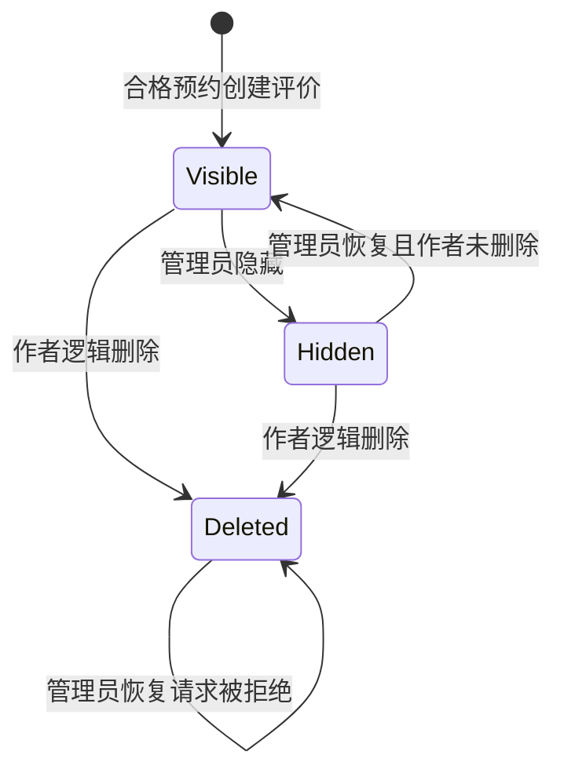

# 智游北京——模块设计

> 文档版本：1.0  
> 设计日期：2026-10-03  
> 适用范围：4 人、暂定 2 周的本机演示项目  
> 文档状态：面向实现的设计稿；本文目录、类和测试均为建议设计，不表示代码已经实现或成员已经分配。

## 1. 设计依据与约定

本文依据 [需求规格说明书](../requirements/requirements.md)、[用户故事](../requirements/user-stories.md)、[验收标准](../requirements/acceptance-criteria.md) 和 [未决问题与决策记录](../requirements/open-questions.md)，细化 [总体架构](./architecture.md)、[接口设计](./api-design.md) 和 [数据设计](./data-design.md) 中的模块协作方式。教师没有指定文档模板，采用课程常见结构；团队分工仍属于建议，未替代 OQ-015 的小组决策。

主要设计约定如下：

- 前端采用 Vue 3、TypeScript、Vite、Vue Router、Pinia；后端采用 FastAPI、Pydantic 2、同步 SQLAlchemy 2、psycopg 3、Alembic；数据库采用 PostgreSQL。
- 后端采用模块化单体，按 Router → Service → Repository 分层。涉及数据库的入口和服务使用同步 `def`，不在异步函数中直接执行同步数据库操作。
- 推荐、交通估算、时间重算、预约状态推导为可独立测试的纯逻辑；数据库、系统时钟和地图链接生成通过接口注入。
- 公共 ID 为 UUID；金额计算使用 `Decimal`，API 使用十进制字符串；业务日期以 `Asia/Shanghai` 判断，持久化事件时间为 UTC。
- 分类、兴趣标签、场次等使用接口与数据设计中的固定代码，前端展示中文名称。搜索的多个标签采用全部匹配；推荐兴趣采用交集匹配。
- 所有个人资源都由服务器会话确定当前用户。客户端不得通过提交 `user_id` 指定资源所有者。

## 2. 模块职责与边界

| 模块 | 前端责任 | 后端责任 | 主要拥有的数据 | 边界与优先级 |
| --- | --- | --- | --- | --- |
| `auth` 账号与权限 | 注册、登录、退出、会话恢复、角色路由守卫 | 用户名规范化、密码哈希、会话解析、CSRF、角色依赖 | 用户、会话 | Must；不提供找回密码、账号管理或公开管理员注册 |
| `attractions` 景点目录 | 列表、搜索筛选、详情、地图入口、素材说明 | 可见景点查询、字段校验、管理员景点维护、版本控制 | 景点及其标签、开放时间、支持场次、图片来源 | Must；排序为 Should，嵌入地图为 Should |
| `favorites` 收藏 | 收藏按钮、分页个人收藏、取消操作 | 所有者限定查询、唯一收藏、幂等增加和取消 | 收藏 | Must；不自动引入收藏影响推荐的 Could 功能 |
| `plans` 行程 | 偏好表单、预览、保存、分日展示、同天调整、冲突提示 | 推荐编排、服务器预览快照、方案事务、快照时间与费用重算 | 预览、方案、行程项；行程日为派生分组 | Must；重命名/整份删除为 Should；复制为 Could |
| `bookings` 模拟预约 | 日期/场次/人数表单、个人记录、取消确认 | 创建校验、预约快照、防重复、状态推导、所有者取消 | 预约 | Must；管理员入口只读，不产生库存、支付或真实票务 |
| `reviews` 评价 | 公开评价、可评价预约、个人评价、删除确认 | 资格校验、终身预约唯一性、逻辑删除、隐藏/恢复、公开评分聚合 | 评价 | Must；不允许管理员恢复作者删除的评价 |
| `admin` 后台入口 | 管理员布局、景点编辑、预约查看、评价审核、概览 | 管理员鉴权后的请求编排和统计查询 | 不重复拥有业务实体 | Must 管理能力；概览/排行为 Should |
| `shared/core` 基础能力 | HTTP 客户端、字段错误、分页、通用 UI、地图适配器 | 配置、规则常量、时钟、异常、事务、日志、数据库依赖 | 不拥有个人业务数据 | 服务各模块，不积累无关业务逻辑 |

`admin` 只组织管理入口。例如后台修改景点最终调用 `AttractionService.update()`，后台隐藏评价调用 `ReviewService.set_hidden()`。它不另写一套景点/评价更新逻辑，不允许管理员调用个人预约、取消或评价创建能力。服务端角色依赖独立于页面菜单和路由守卫。

### 2.1 数据所有权与跨模块协作

| 调用方 | 读取能力 | 写入能力与约束 |
| --- | --- | --- |
| `PlanService` | 通过景点目录契约读取已上架候选、保存时读取并锁定对应景点版本 | 只写预览、方案及行程项；不更新景点热度或价格 |
| `BookingService` | 创建时锁定景点，读取支持场次与快照字段 | 只写当前用户预约；不更新景点或库存 |
| `ReviewService` | 通过预约契约读取并锁定当前用户预约，判断资格 | 只写评价；不把预约写为“已评价”来替代唯一约束 |
| `AttractionService` | 读取自身目录数据及公开评价聚合结果 | 修改景点并递增版本；下架不删除历史方案、收藏、预约或评价 |
| `StatisticsQueryService` | 分别聚合用户、景点、收藏、预约、方案及行程偏好 | 只读；统计查询不更改基础热度 |
| `AuthService` | 用户、会话 | 只写账号与会话；不修改其他模块的所有者 |

跨模块读取通过明确的 Repository 只读/加锁接口或业务查询契约完成，不访问另一个模块的 Router，不发站内 HTTP 请求。跨模块事务共用当前业务操作的 Session；只有拥有实体的 Service 可以写该实体。已保存方案使用冻结景点快照进行展示和重算，预约使用预约快照展示；当前景点修改不会回写历史快照。

### 2.2 依赖关系



依赖方向保持单向：Router 不拼接 SQL，Repository 不决定 HTTP 状态，纯推荐引擎不读取数据库，也不调用地图服务。图中的 Repository 为各模块仓储的集合，并非一个包含全部业务方法的类。

## 3. 建议工程目录

下列为后续实现建议，当前任务仅交付架构文档。可以按团队习惯调整文件名，但保留职责边界。

### 3.1 前端

```text
frontend/
  src/
    app/
      main.ts
      router.ts                 # 页面与 guest/user/admin 访问声明
      App.vue
    features/
      auth/                     # pages、api.ts、types.ts、session-store.ts
      attractions/              # 查询列表、详情、筛选、地图入口
      favorites/                # 分页列表和收藏操作
      plans/                    # 偏好、预览、分日方案、同天调整
      bookings/                 # 创建、我的预约、状态与取消反馈
      reviews/                  # 公开列表、创建、我的评价
      admin/                    # 后台布局及上述业务管理页
    shared/
      api/client.ts             # Cookie、CSRF、错误解析、请求超时
      api/contracts.ts          # 与后端 OpenAPI 对齐的类型
      rules.ts                  # 消费 /meta 词表与规则，提供表单提示
      components/               # 分页、空状态、加载、字段错误
      adapters/map.ts           # 消费服务端地图链接、嵌入与降级
      styles/
  tests/
    unit/
    e2e/
```

前端 `session-store` 只保存用户显示信息和内存中的 CSRF token，不把会话 Cookie、密码或 CSRF token 写入本地持久化存储。景点筛选条件放入 URL 查询参数，分页保留筛选条件；个人列表不把其他用户的数据保存在共享全局缓存中。

统一 HTTP 客户端向 `/api/v1` 发请求。本机开发时由 Vite `5173` 将 `/api` 代理到 FastAPI `8000`；演示时将前端构建文件交由 FastAPI 在 `8000` 同源提供。请求发送 Cookie，并在已登录写请求中附加 `X-CSRF-Token`。退出/会话失效时清理个人状态；网络失败不自行重复提交预约等非幂等写操作。

### 3.2 后端

```text
backend/
  app/
    main.py                     # 注册路由、异常处理、前端静态文件
    core/
      config.py                 # 演示参数和安全配置
      rules.py                  # 词表与业务范围常量
      clock.py                  # UTC 时钟与上海业务日期
      security.py               # Argon2id、会话摘要、Origin/CSRF
      validators.py             # 用户名、金额、时间等共用校验
      errors.py                 # 业务异常与统一错误映射
      maps.py                   # MapAdapter：生成受控地图URL
    db/
      base.py
      session.py                # SessionFactory
      uow.py                    # Service 控制的事务单元
    modules/
      auth/
      attractions/
      favorites/
      plans/
        router.py
        schemas.py
        models.py
        repository.py
        service.py
        domain/
          recommendation.py     # 纯推荐逻辑
          schedule.py           # 快照时间与交通重算
      bookings/
      reviews/
      admin/
    scripts/
      seed.py                   # 20～30 个景点、管理员与演示数据
  migrations/                   # Alembic 版本化迁移
  tests/
    unit/
    integration/
    conftest.py                 # 固定时钟、数据库隔离、测试用户
```

除 `admin` 外，每个业务模块使用 `router.py / schemas.py / models.py / repository.py / service.py` 的基本结构；小模块可合并文件，但不将事务和业务校验迁入 Router。`admin` 可以只保留 Router、输入/输出 Schema 与只读统计服务。

## 4. 层职责与类/接口设计

### 4.1 分层约束

| 层 | 输入/输出 | 允许的工作 | 禁止的工作 |
| --- | --- | --- | --- |
| Router | Pydantic 请求/响应、`Principal` | 参数解析、注入身份、调用一次业务用例、设置 Cookie/状态码 | 自己提交事务、直接改变 ORM 实体、在控制器中实现推荐 |
| Service | 已验证命令/查询、领域结果 DTO | 业务规则、当前时钟、跨仓储编排、事务、结果状态 | 信任客户端所有者、为普通用户使用管理员仓储 |
| Repository | SQLAlchemy Session 与显式参数 | 参数化查询、所有者条件、锁、分页、聚合、持久化 | 提交事务、生成 HTTP 响应、修改范围外实体 |
| Domain | 不可变候选、快照、偏好、配置 | 评分、交通、排程、状态推导、警告 | 读取数据库、系统当前时间、发网络请求 |

`Principal` 至少包含 `user_id`、`role`、`session_id`。它由后端会话解析得出；所有个人 Service 接口接收当前 `user_id`。Repository 的个人查询同时包含资源 ID 和 `user_id`，资源不属于当前用户时统一按未找到处理，避免泄露是否存在。

### 4.2 基础接口

下列签名说明设计意图，不作为已实现代码或完整的可运行样例；HTTP 路径和字段以 [api-design.md](./api-design.md) 为准。

```python
class Clock(Protocol):
    def now_utc(self) -> datetime: ...
    def today_shanghai(self) -> date: ...

class UnitOfWork(Protocol):
    session: Session
    def __enter__(self) -> "UnitOfWork": ...
    def __exit__(self, exc_type, exc_value, traceback) -> None: ...

class AuthService:
    def register(self, command: RegisterCommand) -> UserSummary: ...
    def login(self, command: LoginCommand) -> LoginResult: ...
    def resolve_session(self, raw_session_id: str) -> Principal: ...
    def logout(self, principal: Principal) -> None: ...

class AttractionService:
    def search(self, query: AttractionQuery) -> Page[AttractionSummary]: ...
    def detail(self, attraction_id: UUID) -> AttractionDetail: ...
    def create(self, admin: Principal, command: AttractionCreateCommand) -> AttractionDetail: ...
    def update(self, admin: Principal, attraction_id: UUID,
               command: AttractionPatchCommand, expected_version: int) -> AttractionDetail: ...
    def set_status(self, admin: Principal, attraction_id: UUID,
                   status: Literal["published", "unpublished"],
                   expected_version: int) -> AttractionDetail: ...

class FavoriteService:
    def add(self, user_id: UUID, attraction_id: UUID) -> FavoriteResult: ...
    def remove(self, user_id: UUID, attraction_id: UUID) -> None: ...
    def list_owned(self, user_id: UUID, page: Pagination) -> Page[FavoriteView]: ...
```

用户名由共用校验器去除首尾空白、校验中文/ASCII 英文字母/数字/下划线及 3～20 字符，再只将 ASCII 英文字母转为小写作为唯一键；原合法显示用户名另存。密码严格按原值校验 8～64 字符，不去空白、不截断，使用 `argon2-cffi` 的 Argon2id，由库生成随机盐。

会话 ID 为 32 字节密码学安全随机值，经适合 Cookie 的编码传输；数据库只保存它的 SHA-256 摘要。会话固定 8 小时到期，不因访问延长。Cookie 使用 `HttpOnly`、`SameSite=Lax`；本机 HTTP 演示与后续 HTTPS 的 `Secure` 配置按总体架构处理。登录与 `/auth/me` 返回本会话 CSRF token；所有不安全方法请求验证允许的 `Origin`，已经登录的写请求还验证 `X-CSRF-Token`。

### 4.3 业务接口

```python
class PlanService:
    def preview(self, user_id: UUID, preferences: PlanPreferences) -> PreviewResult: ...
    def save(self, user_id: UUID, preview_id: UUID, name: str) -> SavedPlanResult: ...
    def list_owned(self, user_id: UUID, page: Pagination) -> Page[PlanSummary]: ...
    def detail_owned(self, user_id: UUID, plan_id: UUID) -> PlanDetail: ...
    def move_item(self, user_id: UUID, plan_id: UUID, item_id: UUID,
                  direction: Literal["up", "down"], expected_version: int) -> PlanDetail: ...
    def remove_item(self, user_id: UUID, plan_id: UUID, item_id: UUID,
                    expected_version: int) -> PlanDetail: ...
    def rename(self, user_id: UUID, plan_id: UUID, name: str,
               expected_version: int) -> PlanDetail: ...
    def delete(self, user_id: UUID, plan_id: UUID, expected_version: int) -> None: ...

class BookingService:
    def create(self, user_id: UUID, command: BookingCommand) -> BookingDetail: ...
    def list_owned(self, user_id: UUID, query: BookingQuery) -> Page[BookingSummary]: ...
    def detail_owned(self, user_id: UUID, booking_id: UUID) -> BookingDetail: ...
    def cancel(self, user_id: UUID, booking_id: UUID) -> BookingDetail: ...
    def list_admin(self, admin: Principal, query: AdminBookingQuery) -> Page[AdminBookingView]: ...

class ReviewService:
    def list_public(self, attraction_id: UUID, page: Pagination) -> Page[PublicReview]: ...
    def create(self, user_id: UUID, command: ReviewCommand) -> ReviewDetail: ...
    def list_owned(self, user_id: UUID, page: Pagination) -> Page[ReviewDetail]: ...
    def delete_owned(self, user_id: UUID, review_id: UUID) -> None: ...
    def list_admin(self, admin: Principal, query: AdminReviewQuery) -> Page[AdminReviewView]: ...
    def set_hidden(self, admin: Principal, review_id: UUID, hidden: bool) -> ReviewDetail: ...

class StatisticsQueryService:
    def overview(self, admin: Principal) -> StatisticsOverview: ...
```

收藏、行程、预约、评价的个人入口要求 `role=user`。管理员管理入口要求 `role=admin`，预约后台不提供取消或更新方法。方案名称去除首尾空白后为 1～50 字符，是本设计选定的统一实现校验；`duration_minutes=1～720` 为景点编辑的建议实现参数，并非增加新的旅游服务能力。

### 4.4 核心仓储与纯逻辑契约

```python
class AttractionRepository:
    def list_published_candidates(self) -> list[AttractionCandidate]: ...
    def lock_many(self, ids: list[UUID]) -> list[AttractionRecord]: ...
    def lock_one(self, attraction_id: UUID) -> AttractionRecord | None: ...

class PlanRepository:
    def lock_preview_owned(self, preview_id: UUID, user_id: UUID) -> PreviewRecord | None: ...
    def lock_plan_owned(self, plan_id: UUID, user_id: UUID) -> PlanRecord | None: ...
    def find_by_source_preview_owned(self, preview_id: UUID, user_id: UUID) -> PlanRecord | None: ...
    def persist_aggregate(self, plan: PlanAggregate) -> None: ...

class BookingRepository:
    def lock_owned(self, booking_id: UUID, user_id: UUID) -> BookingRecord | None: ...
    def find_active(self, user_id: UUID, attraction_id: UUID,
                    visit_date: date, slot: str) -> BookingRecord | None: ...

class ReviewRepository:
    def lock_owned(self, review_id: UUID, user_id: UUID) -> ReviewRecord | None: ...
    def lock_admin(self, review_id: UUID) -> ReviewRecord | None: ...
    def exists_for_booking(self, booking_id: UUID) -> bool: ...
    def aggregate_public_rating(self, attraction_id: UUID) -> RatingSummary: ...

class RecommendationEngine:
    def generate(self, preferences: PlanPreferences,
                 candidates: Sequence[AttractionCandidate],
                 rules: RecommendationRules) -> GeneratedPlan: ...

class ScheduleCalculator:
    def recalculate_day(self, date: date, daily_start: time, daily_end: time,
                        ordered_snapshots: Sequence[PlanItemSnapshot]) -> DaySchedule: ...

def derive_booking_status(visit_date: date, cancelled_at: datetime | None,
                          today: date) -> Literal["pending", "completed", "cancelled"]: ...
```

公开平均评分只聚合 `hidden_at IS NULL AND deleted_at IS NULL` 的评价，无评价时返回空平均值和数量 0。查询即时计算，不缓存平均值，不把用户评分用于推荐的基础热度。

## 5. 推荐与排程模块

### 5.1 候选、约束与评分

候选 DTO 包含 UUID、名称、地址、WGS84 经纬度、分类、兴趣标签、参考票价、建议时长、基础热度、星期开放规则和景点版本。全程预置景点数量约 20～30，使用确定性的两阶段贪心算法：先尽量为各日放入一个景点，再逐日追加，缓解第一天占用所有候选的问题；不依赖外部 AI、Redis 或路线规划 API。

推荐先进行硬约束筛选，再进行兴趣优先级与加权排序：

1. 景点必须上架，未在本方案使用，票价不超过全程剩余预算。
2. 当日星期必须开放。到达后允许等待开门，但完整游玩时段必须同时落入营业时间与用户每日可用时间。
3. 当存在满足硬约束且与用户兴趣有交集的候选时，优先从这一组选择；只有这一组为空时才选择无交集的补充候选。这保证需求 7.1 的兴趣优先要求，不被其他分数抵消。
4. 每组内按标准化加权分数降序选择，完全同分时按景点 UUID 稳定排序。

对本次选择的剩余预算 `remaining_budget` 和上一景点定义：

| 因子 | 公式 | 说明 |
| --- | --- | --- |
| 兴趣 `I` | `交集标签数 / 用户所选标签数` | 输入保证至少一个兴趣；每个因子落在 0～1 |
| 热度 `H` | `base_popularity / 100` | 使用预置基础热度 |
| 预算 `B` | `1 - ticket_price / remaining_budget` | 剩余预算为 0 且票价为 0 时为 1；非零票价已被硬过滤 |
| 距离 `D` | 首项为 1；其余为 `1 / (1 + distance_km / 10)` | 距离由 WGS84 经纬度的 Haversine 公式计算 |
| 加权分 | `0.40I + 0.25H + 0.20B + 0.15D` | 权重集中配置且合计为 1，演示记录实际值 |

兴趣分组为排序的第一关键字，加权分为第二关键字。若前端展示统一的排序总分，可使用 `tier + weighted_score`；`tier=1` 表示匹配兴趣、`tier=0` 表示补充候选，匹配组 `I>0`，从而总分严格高于补充组。推荐理由另外返回中文因素解释，避免仅用数值解释推荐。

每日首个景点交通时间设为 0，因为需求未输入住处或起点。其余相邻景点交通时间为 `ceil_to_5(distance_km / 20 × 60 + 15)` 分钟。预算为全程一人参考门票合计，不包含住宿、餐饮和真实交通；预约的人数及金额不回写方案预算。

### 5.2 生成伪代码

```text
generate(preferences, candidates, rules):
    result = 每天一个空行程日
    used_ids = 空集合
    remaining_budget = preferences.budget
    为每一天初始化 cursor = 当天每日开始时刻, previous = null

    append_one(day):
        feasible = []
        for candidate in candidates:
            if 未上架 or 已使用 or 票价 > remaining_budget: continue
            opening = candidate.weekly_hours[day.date.isoweekday()]
            if 当日关闭: 记录排除原因; continue
            travel = 0 if day.previous为空 else estimate_travel(day.previous, candidate)
            arrival = day.cursor + travel
            visit_start = max(arrival, opening.opens_at)
            visit_end = visit_start + candidate.duration_minutes
            if visit_end > min(opening.closes_at, preferences.daily_end):
                记录时间排除原因; continue
            tier = 1 if 兴趣交集非空 else 0
            score = 按当前remaining_budget与day.previous计算加权分
            feasible.append(candidate, tier, score, travel, visit_start, visit_end)

        if feasible为空: return false
        chosen = 按 tier降序、score降序、UUID升序 的第一个候选
        在day添加chosen的冻结快照、时段、交通、费用与理由
        used_ids.add(chosen.id)
        remaining_budget -= chosen.ticket_price
        day.cursor = chosen.visit_end
        day.previous = chosen
        return true

    # seed 阶段：全局共享预算和已使用集合
    for day in 从第1天至第days天:
        append_one(day)
    # extend 阶段：逐日继续追加，不回溯或跨日移动已选项
    for day in 从第1天至第days天:
        while append_one(day): continue

    if 所有日均为空: result_status = no_solution
    else if 至少一天为空: result_status = partial
    else: result_status = complete
    添加候选不足、预算或开放/时间排除的中文解释与warning code
    return result
```

总候选数为 `n`，每天最多选中 `n` 个景点，最多 7 天，时间复杂度上界为 `O(days × n²)`，空间复杂度为 `O(n + 行程项数)`。该算法提供可解释可行方案，不承诺景点数、分数或旅行成本的数学最优，也不把未用满预算、未排满时间自动认定为失败。

生成警告使用 `NO_PUBLISHED_ATTRACTIONS`、`BUDGET_LIMIT`、`TIME_LIMIT`、`CANDIDATES_EXHAUSTED` 等代码，并附具体中文说明；`TIME_LIMIT` 可以说明当日关闭、开放时段不容纳游玩或每日时间不足。结果 `no_solution` 返回明确反馈且不存储空预览；非空结果持久化预览快照，有效期 30 分钟。候选与关联表在一个短一致性只读事务中批量加载为 DTO，再关闭 Session 执行纯计算，避免不同时间读到混合版本或在循环内查库。Service 统一控制生成耗时及数据库超时，超出 5 秒的生成返回 503 `PLAN_GENERATION_TIMEOUT`，不持久化半成品。

### 5.3 已保存方案重算

手动调整由 `ScheduleCalculator` 按冻结快照重算，不重新推荐，也不以最新景点价格或营业规则覆盖历史信息。流程如下：

1. 锁定当前用户的方案父行，验证 `expected_version`。
2. 上移/下移只交换同一天相邻两项；首项上移、末项下移、跨天移动等无效操作拒绝。
3. 删除时允许删去最后一项，保留空行程日；其余项保持相对顺序。
4. 每天从每日开始时刻顺序计算交通和到达时间。开放日使用 `max(arrival, opens_at)`；快照中当日关闭时仍从到达时间计算，附开放时间冲突警告。
5. 重算总票价、交通、等待和预计时段；超出关闭时间、每日可用时间或自然日边界时附 `OPENING_TIME_CONFLICT`、`DAILY_TIME_EXCEEDED`、`DAY_OVERFLOW`。
6. 保存调整、警告与费用，方案版本加 1；存在警告不回滚已授权的手工调整。

内部时刻使用相对该游玩日 00:00 的非负分钟数，允许超过 1439，避免跨日结果被截断或错误绕回 00:00。API 由游玩日加分钟数转换为带 `+08:00` 的完整 `scheduled_start / scheduled_end`，前端明确显示“次日”等跨日提示。输入的每日时间和开放时段仍为不跨夜的 `HH:mm`。日 `total_duration_minutes` 为最晚结束减每日开始，包含交通和等待，空日为 0；历史查询可附 `ATTRACTION_UNAVAILABLE` 当前状态诊断，不改写冻结时段、费用或方案版本。

## 6. 关键协作流程与状态

### 6.1 预览生成与可信保存



保存只接收 `preview_id` 与名称，不能由客户端提交价格、评分、理由或整份行程项作为可信数据。`source_preview_id` 唯一约束与预览行锁保证同一预览不会产生两份方案。已经消费的预览重试优先返回仍存在的原方案，即使预览后来到期；原方案已删则拒绝重新消费，防止删除后被重试请求恢复。

### 6.2 预约创建与取消



创建只使用需求确认的预约限制：上架且可预约、当天至未来 90 天、支持场次、人数 1～10、未取消组合唯一。不因星期闭馆、剩余库存或实际票务状态额外拒绝模拟预约。锁定景点使预约创建与管理员修改/下架串行，提交时快照与被校验的目录状态保持一致。



取消在锁定当前用户预约后判断；当天不允许取消。状态推导优先级为：存在 `cancelled_at` → `cancelled`；否则 `visit_date < today` → `completed`；否则 `pending`。无需定时任务或把所有历史预约状态逐日改写。已取消预约的重复取消返回业务冲突，不产生二次状态变化。

### 6.3 评价资格与可见性

创建评价以预约 ID 为入口，锁定属于当前用户的预约，要求未取消、游览日期早于当天，评分为整数 1～5，去除首尾空白后的正文长度为 5～500。数据库对 `booking_id` 保持终身唯一：作者删除评价后也不能针对同一预约再次评价。



实现时使用两个独立维度 `hidden_at` 和 `deleted_at`，而非通过一个枚举覆盖历史信息。公开查询同时排除隐藏和作者删除；作者删除不可由管理员恢复。隐藏、恢复、删除之后的查询直接进行 SQL 聚合，避免维护评分缓存时出现丢失更新。

## 7. 事务、并发与异常策略

### 7.1 事务归属

每个业务写用例由 Service 打开一个 UnitOfWork，相关仓储共用一个 SQLAlchemy Session。Service 正常结束后提交，任意异常回滚；Repository 可以 `flush` 以获得 ID 或提早检查约束，但不能 `commit`。身份依赖使用独立短读 Session 解析 Principal 并关闭，再进入业务事务，避免身份查询触发的自动事务与业务 `begin` 重叠。

| 用例 | 同一事务内的工作 | 并发保障 |
| --- | --- | --- |
| 注册 | 校验规范化用户名、写用户 | 规范化用户名唯一约束，冲突转用户名已使用 |
| 登录/退出 | 创建会话/使当前会话失效 | Session 摘要唯一；固定到期判定 |
| 收藏 | 增加或删除当前用户收藏 | `(user_id, attraction_id)` 唯一；重复增加采用明确幂等反馈 |
| 保存预览 | 锁预览、检查消费、验证日期和目录、写方案及所有项、标记消费 | 预览行锁、景点按 UUID 顺序行锁、`source_preview_id` 唯一 |
| 调整/重命名/删除方案 | 锁父方案、检查版本、编辑项、重算、版本加 1 | 所有编辑先锁同一个方案父行；不按行程项各自独立提交 |
| 新建预约 | 锁景点、检查规则、写编号与快照 | 未取消组合的部分唯一索引；与景点修改/下架使用同一行锁 |
| 取消预约 | 锁所有者预约、检查日期及取消状态、写 `cancelled_at` | 预约行锁防并发取消 |
| 创建评价 | 锁所有者预约、检查资格、写评价 | `booking_id` 唯一；逻辑删除不释放名额 |
| 作者删除/管理员隐藏恢复 | 锁评价、检查所有者或角色及删除状态、修改标记 | 评价行锁；恢复时禁止覆盖 `deleted_at` |
| 景点修改/上下架 | 锁景点、检查 `expected_version`、完整校验、修改、`version + 1` | 有效变更递增版本；重复设置相同上架状态为 200 无变化，不递增版本 |

时钟在一次业务命令开始时取值并用于全部边界判断，避免执行期间跨午夜时同一请求前后使用不同日期。行锁只在短业务事务内持有，不等待前端确认或外部地图请求。多个景点统一按 UUID 顺序加锁，减少交叉保存的死锁风险。删除来源于预览的方案时，与重复保存路径遵循“先 source 预览、后方案”的共同锁顺序；重排时延迟检查 `(plan_id, day_index, sequence)` 唯一约束，提交前保证顺序连续且唯一。

集中配置使用 `APP_TIMEZONE`、`FRONTEND_ORIGIN`、`SESSION_TTL_HOURS=8`、`PREVIEW_TTL_MINUTES=30`、`PAGE_SIZE_DEFAULT=20` 和 `PAGE_SIZE_MAX=100`，避免多个模块自定默认值。收藏新增要求景点已上架；下架后的已有收藏仍保留并允许取消。

### 7.2 异常传播

| 异常类别 | Service 处理 | 前端反馈与恢复 |
| --- | --- | --- |
| 字段校验失败 | 使用统一字段路径与中文原因，返回 422 | 在表单对应字段提示，保留用户输入 |
| 未登录/会话过期 | 401，不建立个人业务事务 | 清理个人状态并引导登录 |
| 角色不允许/Origin 或 CSRF 无效 | 403 | 显示禁止操作；不依靠隐藏按钮规避错误 |
| 所有者资源不存在 | 404，个人查询已带所有者条件 | 提示记录不可用，不展示他人记录信息 |
| 预览到期、已消费后方案已删、目录变化、方案版本冲突 | 409 与具体错误码 | 重新生成预览或刷新方案；不静默覆盖 |
| 重复预约/重复评价/状态不允许 | 409 与可理解原因 | 保留表单或刷新已有记录 |
| 数据库必要依赖不可用 | 回滚，记录请求 ID 和内部原因，返回 503 | 提示服务暂不可用；不展示连接凭据 |
| 未知服务器错误 | 回滚，记录请求 ID 和内部原因，返回通用 500 | 提示稍后重试；不展示 SQL、堆栈或密码信息 |
| 地图加载或外部网站失败 | 不进入核心写事务 | 保留名称、地址与坐标；显示链接/复制地址的降级提示 |

统一错误响应结构及错误码以接口设计为准。仅捕获明确的数据库约束名并映射对应业务冲突，不能把任意 `IntegrityError` 都当成重复预约。日志记录请求 ID、路径、状态和耗时，脱敏 Cookie、密码、会话原值和 CSRF token。

### 7.3 地图适配器

后端 `MapAdapter` 输入景点名称、地址和 WGS84 经纬度，输出 API 的 `navigation_url`、可选 `map_position_url` 与提示；只接受固定提供商，不将用户输入直接作为任意跳转 URL。前端地图适配层消费这些受控链接，处理呈现、复制地址及嵌入降级，不另维护一套坐标/链接规则。默认导航入口按 [Google Maps URLs 官方协议](https://developers.google.com/maps/documentation/urls/get-started) 构造带 `api=1`、`destination=纬度,经度`、`travelmode=transit` 的外部 directions 链接，无需 API key。外部站点可达性不属于本机项目保证范围。

若补充高德位置链接，遵循 [高德移动网页标点官方协议](https://lbs.amap.com/api/uri-api/guide/mobile-web/point)，明确 `coordinate=wgs84`；该标点入口不冒充路线导航。后续接入需要其他坐标系的提供商，应在适配器中按其官方协议转换，禁止直接把 WGS84 当作 GCJ-02。嵌入地图为 Should；失败时不影响景点详情、行程、预约及评价。

## 8. 前端状态与用户反馈

| 页面/操作 | 必须处理的状态 | 关键交互 |
| --- | --- | --- |
| 景点列表 | 加载、有数据、无匹配、网络失败 | 改筛选回第一页；刷新/翻页保留条件；不把空结果显示为系统错误 |
| 登录/注册 | 编辑、提交中、字段错误、成功 | 凭据失败统一提示，不区分用户名或密码错误 |
| 行程生成 | 编辑、生成中、完整、部分、无方案、失败 | 展示每日安排、理由、参考费用/交通；无方案不显示可保存按钮 |
| 行程保存 | 有效预览、保存中、已保存、到期/目录变化 | 禁用重复点击；以服务器同预览幂等结果处理网络重试 |
| 行程编辑 | 可编辑、提交中、版本冲突、带警告成功 | 同天上/下移按钮边界禁用；保留冲突结果且突出警告 |
| 预约/评价 | 编辑、提交中、资格错误、成功 | 防止重复点击；重试仍受数据库唯一约束保护 |
| 个人/后台列表 | 加载、空、分页、有数据、错误 | 不设置记录总量上限；页码、筛选及总数一致 |
| 地图 | 可打开、嵌入加载中、外部不可达 | 地址/坐标可复制，核心内容始终可访问 |

请求中的版本号来自最近一次方案响应。发生 409 时先刷新服务器结果，用户再决定操作；不在后台自行把 `expected_version` 替换成新版本后重试。前端按纯文本呈现评论和简介，不用 `v-html` 插入未经处理的用户内容。

## 9. 自动化测试与验收映射

测试结构分为：纯逻辑单元测试、真实 PostgreSQL 的仓储/接口集成测试、少量浏览器端到端测试。涉及部分唯一索引、行锁和 JSONB 的验证使用 PostgreSQL，不能仅用 SQLite 替代。通过可注入 Clock 固定“今天”，通过固定候选集合保证推荐稳定；不为课程正常数据规模引入大型分布式测试平台。

| 测试组 | 必测场景 | 需求与验收关联 |
| --- | --- | --- |
| 用户名与密码 | 中文合法用户名、3/20 与 2/21 边界、ASCII 大小写及首尾空白判重、密码原值和 8/64 边界、哈希非明文 | FR-AUTH-001～002；AC-US-004；AC-NFR-003 |
| 会话与权限 | 凭据错误同文案、退出/8 小时到期、用户直调后台、管理员不能提交个人预约或评价、伪造/缺失 CSRF、非法 Origin | FR-AUTH-003～005、FR-ADM-001；AC-US-005～006；AC-NFR-003 |
| 所有者隔离 | 用户 A 直接请求用户 B 的收藏、方案、预约、评价读写，数据不变 | NFR-SEC-004；AC-US-006、AC-US-021 |
| 搜索与筛选 | 名称/简介搜索、分类/价位/多个标签全部匹配、组合分页、无结果、稳定排序 | FR-POI-001～007；AC-US-001～002、AC-US-008 |
| 收藏幂等 | 重复收藏仅一行、重复取消明确反馈、个人列表隔离 | FR-FAV-001～003；AC-US-007 |
| 偏好校验 | 当天/过去日期、1/7 天边界、无兴趣、负预算、每日结束不晚于开始 | FR-PLAN-001～002；AC-US-010 |
| 推荐规则 | 兴趣分组优先、因子变化、零预算免费景点、无重复、星期闭馆排除、等待开门、费用/每日时间硬约束 | FR-PLAN-003～005、需求7.1～7.2；AC-US-011 |
| 交通估算 | Haversine 固定点对、每日首项为 0、20km/h+15 分钟、向上取整 5 分钟 | FR-PLAN-004～005；AC-US-011 |
| 结果分级 | seed阶段先各日1项再追加、每日非空 complete、空天 partial、全空 no_solution 不存预览、剩余预算/时间未满不视为错误 | FR-PLAN-006；AC-US-011 |
| 预览保存 | 非空快照持久化、他人预览不可保存、到期/过去日期拒绝、景点版本/下架变化、重复保存同 ID、消费后删除不复活 | FR-PLAN-007、NFR-REL-001；AC-US-012、AC-NFR-004 |
| 方案调整 | 同天相邻交换、边界禁止、删末项保留空天、价格快照不被现价覆盖、重算超时/闭馆/跨日警告保留、过期版本拒绝 | FR-PLAN-008、FR-PLAN-012；AC-US-013 |
| 方案管理 | 所有者重命名和删除、级联行程项删除、其他用户拒绝 | FR-PLAN-009；AC-US-014（Should） |
| 预约边界 | today/today+90、today-1/today+91、人数1/10及0/11、场次不支持、必填缺失 | FR-BOOK-001～003；AC-US-016 |
| 并发预约 | 同组合并发只成功一条、取消后可重新预约、创建与下架串行快照一致 | FR-BOOK-007、NFR-REL-001；AC-US-016、AC-NFR-004 |
| 状态和取消 | 当天 pending 且不可取消、未来可取消、过去 completed、取消优先、重复取消无第二次变化 | FR-BOOK-004～006；AC-US-017～018 |
| 评价资格 | 完成且未取消的本人预约可评、当天/他人/已取消不可评、整数评分及正文边界、并发及作者删除后不可再评 | FR-REV-002～004；AC-US-020 |
| 可见性与评分 | 隐藏与逻辑删除不公开/不计分、恢复隐藏有效、删除不可恢复、无公开评价平均值为空 | FR-REV-001、FR-REV-005～008；AC-US-019、021、024 |
| 景点与历史 | 7天开放规则单段/关闭、坐标价位校验、词表固定、每次变更版本递增、下架后旧行程/预约仍可读/取消/评价 | FR-ADM-002～004；AC-US-022 |
| 管理查询 | 预约多条件筛选且无写入口、全部评价分页、数量与排行公式、同分基础热度及UUID稳定排序 | FR-ADM-005～008；AC-US-023、025（概览为Should） |
| 可靠性与分页 | 保存方案/创建预约中途故障全部回滚；超一页记录仍可访问；无个人记录总量限制 | NFR-REL-001、NFR-PERF-003；AC-NFR-004～005 |
| 地图与呈现 | URL 经纬度顺序/编码、外部失败仍可操作、评论脚本不执行、图片来源标注 | FR-POI-008～009、NFR-REL-002、NFR-DATA-001～002；AC-US-003、009、AC-NFR-003 |
| 核心闭环与性能 | 游客搜索→注册→预览保存调整→预约→评价→后台隐藏；Chrome/Edge及手机宽度；常规响应95%<2s，生成<5s或明确失败 | NFR-PERF-001～002、NFR-COMP-001～002；AC-NFR-001～002 |

浏览器端到端的评价链路使用固定时钟或种子历史预约，不修改系统日期等待一天。性能报告注明 CPU、内存、PostgreSQL 版本、数据规模、样本次数和测量方式；功能通过不等于性能指标已验证。

## 10. 四人建议分工与两周顺序

### 10.1 建议责任划分

以下 A～D 为建议角色，尚未分配给实际成员；任何成员都可以参与集成和评审。

| 建议角色 | 主责模块 | 协作与交付依赖 |
| --- | --- | --- |
| A：前端与体验 | 前端基础、账号/景点/收藏、共同 UI 与地图入口 | 第2天前冻结接口类型；与 B 联调身份，与 C/D 分担行程/预约/后台页面 |
| B：后端基础与景点 | Session/权限/CSRF、数据库迁移骨架、景点/收藏服务、景点后台 | 先交角色和目录接口；评审所有个人资源仓储条件，提供统一UOW |
| C：推荐与行程 | 种子景点、纯推荐/排程、预览/保存/编辑；配合行程页面 | 依赖景点候选契约、固定时钟、方案数据模型；算法与纯测试可先并行 |
| D：预约评价与质量 | 预约/评价、对应后台查询、数据库约束测试、闭环验收及演示记录 | 依赖身份和景点契约；第1周前半即可写边界/状态纯测试；与 A 联调业务页面 |

不把所有测试留给 D：每个模块负责人同时提交模块测试与验收映射，D 负责集成、并发和演示场景协调。跨模块接口变更由调用双方共同检查接口设计；涉及核心业务需求变更仍遵守需求文档的至少两人确认规则。

### 10.2 建议实施顺序

| 日期/阶段 | 建议成果 | 进入下一阶段的条件 |
| --- | --- | --- |
| 第1～2天 | 项目骨架、数据库迁移、词表/错误约定、种子草稿、账号会话、接口类型、纯算法测试夹具 | 本机前后端可连通；注册登录和角色拒绝能演示 |
| 第3～4天 | 景点目录/维护、收藏、MapAdapter Must入口；推荐与时间引擎 | 已上架景点可查询，算法约束测试通过 |
| 第5～7天 | 非空预览持久化、可信保存、方案同天调整；预约/评价主体服务 | 用户能够保存并调整方案；预约/评价资格测试通过 |
| 第8～9天 | 前端个人记录及后台联调、事务/权限/唯一约束验证、历史快照流程 | Must 核心闭环可连续演示，故障不留下半完成数据 |
| 第10～11天 | 集中补 Must 缺口与缺陷；有余量实现排序、方案管理、统计等 Should | Must 验收清单基本通过，再决定 Should 工作量 |
| 第12～14天 | 边界/并发/分页、响应式/浏览器、性能测量、全新数据库启动检查、文档与演示脚本冻结 | 完成已实现范围的验收记录，明确未实现 Should/Could |

该时间表为相对开发日，不代表从文档日期强制开始。依赖关键路径为“身份与景点目录 → 推荐预览与保存 → 行程编辑”和“身份与景点目录 → 预约 → 评价 → 后台可见性”。推荐纯函数、时钟测试夹具、前端模拟响应和预约状态单元测试可以提前并行。

### 10.3 协作和完成标准

- 建议以 `main` 为可演示分支，短功能分支提交小范围变更；合并前由另一成员检查 API/数据/所有者规则与本模块自动测试。
- 每次迁移通过版本管理提交；不手改同一已共享迁移，不用“直接改数据库”代替可重复迁移和种子脚本。
- 从空数据库完成迁移、种子、前后端启动；公开注册只能创建普通用户，管理员由预置脚本生成。
- 所有 Must 验收场景通过，核心安全/业务测试可重复执行；四份架构文档与最终实现差异记录清楚。
- Should/Could 是否实现以实际结果记录；不以未实现增强项掩盖账号、所有者隔离、模拟预约、可信快照或评价规则缺口。

