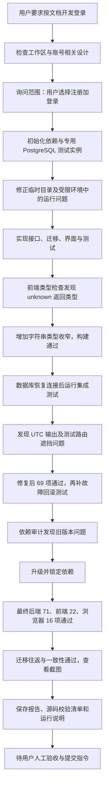
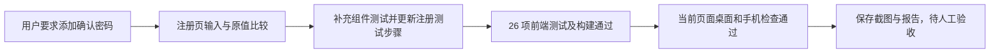

# F001：真实开发 Trajectory

状态：实现及自动化验证完成，待用户人工验收；尚未提交。

- Feature：[注册、登录与会话权限](../features/F001-auth.md)。
- 开发日志：[F001-auth](../agent-logs/F001-auth.md)，节点分别对应步骤 1～12。
- 测试报告：[F001-auth](../../testing/reports/F001-auth.md)。
- 测试源码版本：[SHA-256 清单](../../testing/evidence/F001-auth-manifest.sha256)，Git 基线 `9262b87`，当前未提交。
- 没有绘制尚未发生的团队审查、提交或全系统验收。

后续确认密码追加流程（日志步骤 16）：

浏览器专项检查拦截注册响应，未向开发库写入测试数据；本轮未重跑完整后端和端到端套件。
